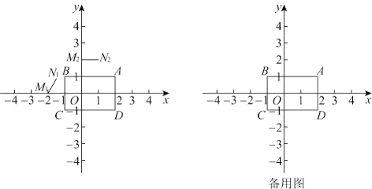

# 2025北京朝阳八年级期末26题

## 题目

在平面直角坐标系 $xOy$ 中, 矩形 $ABCD$ 的顶点分别为 $A(2,1)$, $B(-1,1)$, $C(-1,-1)$, $D(2,-1)$, 线段 $MN$ 在矩形 $ABCD$ 的外面. 给出如下定义: 将线段 $MN$ 关于直线 $l$ 对称, 得到线段 $M'N'$. 若线段 $M'N'$ 不在矩形 $ABCD$ 的外面, 则称线段 $MN$ 为矩形 $ABCD$ 关于直线 $l$ 的对称线段, 线段 $M'N'$ 与线段 $MN$ 中点间的距离为线段 $MN$ 到矩形 $ABCD$ 的对称距离.

（1）如图，已知点 $M_1(-2,0)$，$N_1\left(-\frac{3}{2}, 1\right)$，$M_2(0,2)$，$N_2(1,2)$ 在线段 $M_1N_1$，$M_2N_2$ 中，是矩形 $ABCD$ 关于 $y$ 轴的对称线段的是**\_\_**，该线段到矩形 $ABCD$ 的对称距离为**\_\_**；

（2）过点 $(a,0)$ 作 $x$ 轴的垂线 $l$.  
① 已知点 $M(m,m+4)$，$N(m+1,m+5)$，若存在 $m$，使线段 $MN$ 是矩形 $ABCD$ 关于直线 $l$ 的对称线段，则 $a$ 的取值范围是**\_\_**；  
② 已知点 $M(m,m+4+a)$，$N(m+1,m+5+a)$，若存在 $m$，使线段 $MN$ 是矩形 $ABCD$ 关于直线 $l$ 的对称线段，则线段 $MN$ 到矩形 $ABCD$ 的对称距离 $d$ 的取值范围是**\_\_**。

<ClientOnly>
  <GeoGebra id="gf4uqbsb" :height="500" />
</ClientOnly>
