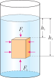

# 浮力

## 浮力

::: info 浮力定义
浸在液体（或气体）中的物体会受到液体（或气体）对它**竖直向上托起的力**，这个力叫作**浮力**。
:::

### 浮力的特点

- 施力物体：液体或气体
- 方向：总是**竖直向上**
- 受力物体：浸在流体中的物体
- 浮力的大小：与液体（或气体）的密度、物体排开流体的体积有关

### 浮力产生的原因

浮力的根源是**液体压强随深度增加而增大**。

设一个长方体浸没在液体中，它的左右两侧受到的液体压力大小相等、方向相反，彼此抵消；但下表面比上表面更深，受到的液体压强更大，因此下表面受到的向上压力大于上表面受到的向下压力，二者的差值就是浮力。

::: formula
$$
F_{\text{浮}} = F_{\text{向上}} - F_{\text{向下}}
$$
:::

这说明浮力本质上是液体对物体各个方向压力的**合力**。

## 阿基米德原理

::: tip 阿基米德原理内容
浸在液体中的物体受到向上的浮力，浮力的大小等于它排开的液体所受的重力。
:::

**公式**
::: formula
$$
F_{\text{浮}} = G_{\text{排}} = m_{\text{排}} g = \rho_{\text{液}} g V_{\text{排}}
$$

- $F_{\text{浮}}$：浮力
- $G_{\text{排}}$：排开液体的重力
- $\rho_{\text{液}}$：液体密度
- $V_{\text{排}}$：物体排开液体的体积
:::

**使用公式时要分清 $V_{\text{排}}$**

- 物体**部分浸入**液体时：$V_{\text{排}}$ 是浸入部分的体积
- 物体**全部浸没**液体时：$V_{\text{排}} = V_{\text{物}}$
- 物体**漂浮**时：$V_{\text{排}} < V_{\text{物}}$

### 浮力与哪些因素有关

根据阿基米德原理浮力大小与下面几个因素有关：

- 与液体密度有关：液体密度越大，浮力越大
- 与排开液体的体积有关：排开液体体积越大，浮力越大
- 与重力加速度 $g$ 有关

在初中阶段通常认为同一地点 $g$ 不变，因此常说浮力大小主要与**液体密度**和**排开液体的体积**有关。

### 浮力与这些因素无关

在液体种类不变、排开液体体积不变的前提下，浮力与下面这些因素无关：

- 与物体浸没后的深度无关
- 与物体本身的密度无关
- 与容器的形状无关

### 阿基米德原理的理解

- 物体受到的浮力，取决于它**排开了多少液体**
- 物体浸在同一种液体中时，排开液体的体积越大，浮力越大
- 在排开液体体积相同时，液体密度越大，浮力越大
- 物体完全浸没后，如果排开液体体积不再变化，浮力通常也不再变化

**易错点**

- 浮力不一定只存在于“浮在水面”的物体上，**只要浸在液体或气体中就可能受浮力**
- “浸没更深，浮力更大”并不总对。对于已经**完全浸没**且排液体积不变的物体，继续下沉不会使浮力变大
- 漂浮和悬浮都满足 $F_{\text{浮}} = G$，但二者所处位置不同

## 物体的浮沉条件及其应用

物体浸没在液体中时，它的浮沉取决于浮力与重力的大小关系。

| 浮沉状态 |       受力关系        |     密度关系      |         状态         |
| :------- | :-------------------: | :---------------: | :------------------: |
| 上浮     | $F_{\text{浮}} > G$   | $\rho_{\text{液}} > \rho_{\text{物}}$ |      非平衡状态      |
| 下沉     | $F_{\text{浮}} < G$   | $\rho_{\text{液}} < \rho_{\text{物}}$ |      非平衡状态      |
| 悬浮     | $F_{\text{浮}} = G$   | $\rho_{\text{液}} = \rho_{\text{物}}$ | 可停在液面下任何位置 |
| 漂浮     | $F_{\text{浮}} = G$   | $\rho_{\text{液}} > \rho_{\text{物}}$ |   上浮的最终状态   |
| 沉底     | $F_{\text{浮}} + F_N = G$ | $\rho_{\text{液}} < \rho_{\text{物}}$ |   下沉的最终状态   |

### 漂浮与悬浮的区别

- 共同点：都满足 $F_{\text{浮}} = G$
- 不同点：漂浮时物体一部分露出液面，悬浮时物体完全浸在液体中
- 漂浮时 $V_{\text{排}} < V_{\text{物}}$，悬浮时 $V_{\text{排}} = V_{\text{物}}$

### 判断浮沉的两种思路

#### 比受力

- 若 $F_{\text{浮}} > G$，物体上浮
- 若 $F_{\text{浮}} < G$，物体下沉
- 若 $F_{\text{浮}} = G$，物体悬浮或漂浮

#### 比密度

- 若 $\rho_{\text{物}} > \rho_{\text{液}}$，物体下沉
- 若 $\rho_{\text{物}} < \rho_{\text{液}}$，物体上浮，最终漂浮
- 若 $\rho_{\text{物}} = \rho_{\text{液}}$，物体悬浮

### 浮力的应用

- **轮船**：把钢铁做成空心船体，增大排水体积，减小平均密度，从而漂浮
- **潜水艇**：通过改变水舱中水的多少来改变自身重力和平均密度，实现上浮和下潜
- **密度计**：利用漂浮时 $F_{\text{浮}} = G$ 的条件来比较液体密度
- **热气球、飞艇**：空气也会产生浮力，原理与液体浮力类似

## 实验探究

### 来自 PhET 的在线仿真实验

[浮力](./phet-buoyancy)

访问 [PhET 网站](https://phet.colorado.edu/zh_CN/) 查看所有在线仿真实验

### 在线实验

在本实验中，你可以通过调节滑块来改变物块的**高度坐标 ($Y$)**。观察当物块接触水面、部分浸入、以及完全浸入液体时，弹簧测力计读数 ($F$) 的实时变化。

当物块逐渐浸入液体时，排开液体体积不断增大，浮力增大，弹簧测力计示数减小；当物块完全浸没后，排开液体体积不再变化，示数保持不变。

<BuoyancyLab />

