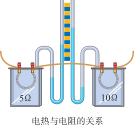
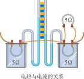

# 电流做功

电，不仅能点亮灯泡、驱动电机，还能产生热量。这些现象背后，是电能转化为其他形式能的过程。这一章从**电能**说起，认识**电功**和**电功率**这两个描述电能转化多少和快慢的核心概念，最后学习电流通过导体发热的规律——**焦耳定律**。

:::: grid 3

::: card title="电能 电功"
电流做功的过程，就是电能转化为其他形式能的过程。电功的大小与电压、电流和通电时间有关——$W = UIt$。
:::

::: card title="电功率"
电功率表示电流做功的快慢。不同的用电器功率千差万别，额定功率和实际功率的区分是关键。
:::

::: card title="焦耳定律"
电流通过导体时会产生热量。$Q = I^2Rt$ —— 电热与电流的二次方成正比，与电阻和通电时间成正比。
:::

::::

## 电能 电功

### 电能的来源与转化

现代社会离不开电能。电能可以从其他形式的能转化而来，也可以转化为其他形式的能：

| 能量转化方向 | 实例 | 说明 |
| :--- | :--- | :--- |
| 其他能 → 电能 | 发电机（机械能→电能）、电池（化学能→电能）、太阳能电池（光能→电能） | 这些装置都是**电源** |
| 电能 → 其他能 | 灯泡（电能→光能+内能）、电饭煲（电能→内能）、电动机（电能→机械能） | 这些装置都是**用电器** |

::: info 用电器利用电能
电能通过各种用电器转化为我们需要的其他形式的能。电流通过用电器时，会"做功"——把电能转化为其他形式的能。
:::

### 电功

**电功** (electric work) 是指电流通过用电器时所做的功。电流做了多少功，就表示有多少电能转化为其他形式的能。

::: formula
$$
W = UIt
$$

- $W$：电功 —— 焦耳（J）
- $U$：电压 —— 伏特（V）
- $I$：电流 —— 安培（A）
- $t$：时间 —— 秒（s）
:::

当电压、电流、时间单位分别为 $\text{V}$、$\text{A}$、$\text{s}$ 时，电功的单位是**焦耳**（$\text{J}$）。

::: info 电功的常用单位
生活中电功（电能）的常用单位是**千瓦时**（$\text{kW} \cdot \text{h}$），俗称"度"。

$$1\ \text{kW} \cdot \text{h} = 3.6 \times 10^6\ \text{J}$$
:::

### 电能表

**电能表**（电度表）是测量用电器在某一段时间内消耗电能（即电流做功）多少的仪表。

电能表上几个重要参数的含义：

| 参数 | 含义 |
| :--- | :--- |
| $220\ \text{V}$ | 额定电压（在 $220\ \text{V}$ 电路中使用） |
| $10(20)\ \text{A}$ | 标定电流 $10\ \text{A}$，额定最大电流 $20\ \text{A}$ |
| $600\ \text{r}/(\text{kW} \cdot \text{h})$ | 每消耗 $1\ \text{kW} \cdot \text{h}$ 电能，转盘转 $600$ 圈 |
| $\text{imp}/(\text{kW} \cdot \text{h})$ | 每消耗 $1\ \text{kW} \cdot \text{h}$，指示灯闪烁的次数（电子式电能表） |

## 电功率

### 电功率的概念

**电功率** (electric power) 表示电流做功的快慢，即单位时间内电流所做的功。

::: formula
$$
P = \frac{W}{t} = UI
$$

- $P$：电功率 —— 瓦特（W）
- $W$：电功 —— 焦耳（J）
- $t$：时间 —— 秒（s）
- $U$：电压 —— 伏特（V）
- $I$：电流 —— 安培（A）
:::

电功率的基本单位是**瓦特**（$\text{W}$）。常用单位还有千瓦（$\text{kW}$）：
$$1\ \text{kW} = 1000\ \text{W}$$

### 额定功率与实际功率

::: tip 额定功率
🎯 **额定电压** (rated voltage)：用电器**正常工作**时的电压。

🎯 **额定功率** (rated power)：用电器在额定电压下工作时的功率。
:::

实际功率与额定功率的关系：

| 条件 | 实际功率与额定功率 | 后果 |
| :--- | :--- | :--- |
| $U_\text{实} = U_\text{额}$ | $P_\text{实} = P_\text{额}$ | 正常工作 |
| $U_\text{实} < U_\text{额}$ | $P_\text{实} < P_\text{额}$ | 不能正常工作，可能功率不足 |
| $U_\text{实} > U_\text{额}$ | $P_\text{实} > P_\text{额}$ | 可能损坏用电器 |

::: warning 电路安全
用电器两端电压过高时，实际功率会超过额定功率，可能烧毁用电器。因此在连接电路时要注意电源电压与用电器的额定电压匹配。
:::

### 串、并联电路中的电功率

**串联电路**（电流 $I$ 相同）：

::: formula
$$
P_1 : P_2 = U_1 : U_2 = R_1 : R_2
$$
:::

电功率与电阻成正比。

**并联电路**（电压 $U$ 相同）：

::: formula
$$P_1 : P_2 = I_1 : I_2 = \frac{1}{R_1} : \frac{1}{R_2}$$
:::

电功率与电阻成反比。

### 电功率的常用公式

| 公式 | 适用场景 |
| :--- | :--- |
| $P = UI$ | 通用公式，已知电压和电流 |
| $P = I^2R$ | 纯电阻电路且已知电流和电阻（常用于串联电路） |
| $P = \dfrac{U^2}{R}$ | 纯电阻电路且已知电压和电阻（常用于并联电路或额定功率计算） |

### 常见用电器的电功率

| 用电器 | 电功率 |
| :--- | :--- |
| 普通灯泡 | 约 $20\ \text{W}$ ~ $100\ \text{W}$ |
| 日光灯 | 约 $40\ \text{W}$ |
| 电视机 | 约 $100\ \text{W}$ ~ $300\ \text{W}$ |
| 电冰箱 | 约 $100\ \text{W}$ ~ $200\ \text{W}$ |
| 电饭煲 | 约 $500\ \text{W}$ ~ $1000\ \text{W}$ |
| 空调 | 约 $1000\ \text{W}$ ~ $3000\ \text{W}$ |

## 焦耳定律

### 电流的热效应

电流通过导体时，导体发热的现象叫做**电流的热效应**。

生活中利用电流热效应的例子：
- 电饭煲、电热水壶利用电流热效应加热食物和水
- 电热毯利用电流热效应取暖
- 电烙铁利用电流热效应熔化焊锡

### 电流发热与电阻的关系

在电流 $I$ 和通电时间 $t$ 一定时，电流通过导体产生的热量 $Q$ 与电阻 $R$ 成正比：$Q \propto R$。

电阻越大的导体，在相同电流和通电时间下产生的热量越多。

### 电流发热与电流的关系

在电阻 $R$ 和通电时间 $t$ 一定时，电流通过导体产生的热量 $Q$ 与电流的平方 $I^2$ 成正比：$Q \propto I^2$。

电流增大到原来的 $2$ 倍，产生的热量会增大到原来的 $4$ 倍。

### 焦耳定律

英国物理学家**焦耳**通过大量实验发现：

::: tip 焦耳定律
电流通过导体产生的热量与电流的二次方成正比，与导体的电阻成正比，与通电时间成正比。这就是**焦耳定律** (Joule's law)。
:::

::: formula
$$
Q = I^2Rt
$$

- $Q$：热量 —— 焦耳（J）
- $I$：电流 —— 安培（A）
- $R$：电阻 —— 欧姆（$\Omega$）
- $t$：时间 —— 秒（s）
:::

::: warning 区分电功与电热

| 比较项 | 电功 $W$ | 电热 $Q$ |
| :--- | :--- | :--- |
| 定义 | 电流做的功，电能转化为其他形式能的总量 | 电流通过导体时产生的热量 |
| 公式 | $W = UIt$ | $Q = I^2Rt$ |

**电功和电热的关系**
- 对于纯电阻电路（如电饭煲、电热水壶），$W = Q$（电能全部转化为内能）
- 对于非纯电阻电路（如电动机），$W > Q$（电能转化为机械能和内能）
:::

### 电热的利用与防止

**利用电热**：电热水器、电饭煲、电熨斗、电热孵化器等。

**防止电热**：电脑 CPU 装散热风扇和散热片、电视机外壳有散热孔、大功率电器使用粗导线减小电阻以减少发热。

## 速记

::: card

- **电功**：$W = UIt$，电流做功的多少
- **电功率**：$P = UI = \dfrac{W}{t}$，电流做功的快慢
- **额定功率**：用电器在额定电压下的功率，$P_\text{额} = \dfrac{U_\text{额}^2}{R}$ （纯电阻电路）
- **焦耳定律**：$Q = I^2Rt$，电热与 $I^2$、$R$、$t$ 成正比
- **纯电阻电路**：$W = Q$；**非纯电阻电路**：$W > Q$
- $1\ \text{kW} \cdot \text{h} = 3.6 \times 10^6\ \text{J}$

:::
