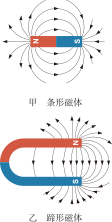
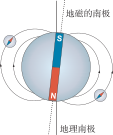
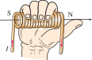
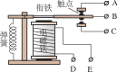

# 电与磁

电与磁看似是两个独立的现象，却有着千丝万缕的联系。早在 19 世纪初，奥斯特发现电流能产生磁场，揭开了电与磁相互转化的序幕；随后法拉第发现了电磁感应——磁也能生电。这一章将带你认识**磁现象**、**电生磁**、**电磁铁**、**电动机**和**磁生电**，领略电磁世界的奇妙。

:::: grid 3

::: card title="磁现象与磁场"
磁体周围存在磁场，磁感线可以形象地描述磁场。地球本身就是一个大磁体，地磁场的存在引导着指南针指向南北。
:::

::: card title="电与磁的相互转化"
奥斯特实验（电生磁）和法拉第电磁感应（磁生电）是电磁学的两大基石。通电导体在磁场中受力，则是电动机的原理。
:::

::: card title="电磁技术的应用"
电磁铁、电磁继电器、电动机、发电机——这些电磁技术的应用深刻地改变了人类社会的生产和生活方式。
:::

::::

## 磁现象 磁场

### 磁现象

**磁性**：物体能够吸引铁、钴、镍等物质的性质叫做**磁性**（magnetism）。

**磁体**：具有磁性的物体叫做**磁体**（magnet）。磁体上磁性最强的部分叫做**磁极**（magnetic pole）。

| 磁极 | 特点 |
| :--- | :--- |
| **南极**（S 极） | 磁体静止时指南的一端 |
| **北极**（N 极） | 磁体静止时指北的一端 |

每个磁体都有**两个磁极**，磁极间的相互作用规律：

- **同名磁极相互排斥**
- **异名磁极相互吸引**

**磁化**：使原来没有磁性的物体获得磁性的过程叫做**磁化**（magnetization）。铁棒被磁化后，磁性可以长期保持，称为**永磁体**；而软铁棒被磁化后磁性容易消失。

### 磁场

**磁场**（magnetic field）是磁体周围存在的一种看不见、摸不着的特殊物质。

磁场的性质：磁场对放入其中的磁体产生**力**的作用。

**磁场的方向**：在磁场中的某一点，小磁针静止时**北极所指的方向**就是该点的磁场方向。

### 磁感线

为了形象地描述磁场，我们引入了**磁感线**（magnetic field lines）——用一些带箭头的曲线来表示磁场的分布情况。

磁感线的特点：

- 磁感线上某点的**切线方向**就是该点的磁场方向
- 磁感线从磁体的**N 极出发**，回到**S 极**
- 磁感线是**闭合的曲线**
- 磁感线的**疏密**表示磁场的强弱——越密的地方磁场越强
- 磁感线**不相交**
- 磁感线是假想的曲线，实际并不存在

常见的磁体磁感线分布：

| 磁体类型 | 磁感线分布特点 |
| :--- | :--- |
| 条形磁体 | N 极发出，回到 S 极，两端密中间疏 |
| 蹄形磁体 | N 极发出，回到 S 极，两极之间近似平行 |
| 同名磁极 | 磁感线相互"排斥"弯曲 |
| 异名磁极 | 磁感线从 N 极直接连到 S 极 |

### 地磁场

地球是一个巨大的磁体，地球周围存在的磁场叫做**地磁场**（earth's magnetic field）。

地磁场的特点：

- 地磁场的形状与条形磁体的磁场相似
- 地磁场的**南极**在地理**北极**附近，地磁场的**北极**在地理**南极**附近
- 地磁场的南北极与地理南北极并不完全重合，存在一定夹角——**磁偏角**。我国宋代学者**沈括**最早发现了磁偏角

::: info 指南针
**指南针**是利用磁体在地磁场中受力而指示南北方向的装置，是中国古代四大发明之一。静止时，磁针的 S 极指向地理南极（即地磁北极附近），N 极指向地理北极（即地磁南极附近）。
:::

## 电生磁

### 电流的磁效应——奥斯特实验

1820 年，丹麦物理学家**奥斯特**（Oersted）发现：通电导线周围存在磁场——这就是**电流的磁效应**（magnetic effect of electric current）。

| 实验情况 | 现象 |
| :--- | :--- |
| 导线通电 | 小磁针发生偏转 |
| 导线断电 | 小磁针回到原位 |
| 改变电流方向 | 小磁针偏转方向改变 |

奥斯特实验表明：

1. 通电导体周围存在**磁场**
2. 磁场的方向与**电流的方向**有关

这是历史上首次揭示了电与磁之间的联系，标志着电磁学的开端。

### 通电螺线管的磁场

**螺线管**（solenoid）是把导线绕成螺旋状的线圈。通电螺线管的磁场与**条形磁体**的磁场相似。

通电螺线管磁场的特点：

- 通电螺线管外部的磁场从 N 极出发，回到 S 极
- 内部磁场从 S 极指向 N 极，是**匀强磁场**
- 通电螺线管两端的极性由**电流方向**决定

### 安培定则

**安培定则**（Ampere's rule，又称右手螺旋定则）用来判断通电螺线管的磁极方向与电流方向的关系：

::: tip 安培定则
**用右手握住螺线管，让四指弯向螺线管中电流的方向，则拇指所指的那一端就是螺线管的 N 极。**
:::

## 电磁铁 电磁继电器

### 电磁铁

在螺线管中插入一个**铁芯**，在有电流通过时有较强的磁性、没有电流时就失去磁性，这样的装置叫做**电磁铁**（electromagnet）。

**电磁铁与永磁体的对比：**

| 对比项 | 电磁铁 | 永磁体 |
| :--- | :--- | :--- |
| 磁性有无 | 通断电控制 | 始终有磁性 |
| 磁极方向 | 可通过改变电流方向改变 | 固定不变 |
| 磁性强弱 | 可通过调节电流大小改变 | 固定不变 |
| 应用 | 电磁起重机、电铃、电磁继电器 | 指南针、扬声器 |

**影响电磁铁磁性强弱的因素：**

1. **电流大小**：电流越大，磁性越强
2. **线圈匝数**：匝数越多，磁性越强
3. **有无铁芯**：插入铁芯后磁性大大增强

### 电磁继电器

**电磁继电器**（electromagnetic relay）是利用电磁铁来控制工作电路的一种开关。

**构造**：电磁铁（线圈和铁芯）、衔铁、弹簧、触点（动触点和静触点）。

**工作原理**：当低压控制电路接通时，电磁铁产生磁性吸引衔铁，带动动触点与静触点接触，从而接通高压工作电路；当低压控制电路断开时，电磁铁失去磁性，弹簧将衔铁拉回，工作电路断开。

**电磁继电器的应用：**

- **低电压控制高电压**——通过低压电路控制高压电路，保证操作安全
- **远距离控制**——可以在远离现场的地方控制电路
- **自动控制**——与传感器配合实现自动控制（如水位自动报警、温度自动控制）

## 电动机

### 磁场对电流的作用

通电导体在磁场中会受到**力**的作用。

| 条件 | 受力情况 |
| :--- | :--- |
| 导体方向与磁场方向不平行 | 导体受到力的作用 |
| 导体方向与磁场方向平行 | 导体不受力 |
| 改变电流方向 | 受力方向改变 |
| 改变磁场方向 | 受力方向改变 |

**受力方向的决定因素：** 通电导体在磁场中的受力方向与**电流方向**和**磁场方向**有关。

::: info 能量转化
电动机工作时，**电能转化为机械能**。
:::

### 直流电动机

**电动机**（electric motor）是利用通电线圈在磁场中受力转动的原理制成的。

**构造**：主要由**磁体**、**线圈**、**换向器**（commutator）和**电刷**组成。

**换向器的作用**：当线圈刚转过平衡位置时，换向器自动改变线圈中的**电流方向**，使线圈能持续转动下去。

**电动机的优点**：

- 构造简单、体积小
- 控制方便（调节电流可调速，改变电流方向可反转）
- 效率高、无污染

## 磁生电

### 电磁感应——法拉第实验

1831 年，英国物理学家**法拉第**（Faraday）发现：**闭合电路的一部分导体在磁场中做切割磁感线运动时，导体中就产生电流。** 这种现象叫做**电磁感应**（electromagnetic induction），产生的电流叫做**感应电流**（induced current）。

**产生感应电流的条件：**

1. 电路是**闭合**的
2. 导体做**切割磁感线**运动

**影响感应电流方向的因素：**

- **磁场方向**——磁场方向改变，感应电流方向改变
- **导体运动方向**——导体切割磁感线的方向改变，感应电流方向改变

**影响感应电流大小的因素：**

- 导体运动速度越快，感应电流越大
- 磁场越强，感应电流越大
- 线圈匝数越多，感应电流越大

::: info 能量转化
发电机工作时，**机械能转化为电能**。
:::

### 发电机

**发电机**（generator）是利用**电磁感应**原理将机械能转化为电能的装置。

**构造**：主要由**磁体**、**线圈**、**滑环**和**电刷**组成。

**交流电**（alternating current, AC）：周期性改变方向的电流。我国电网以 **50 Hz** 的频率提供交流电，即电流方向每秒改变 **100** 次。

| 对比项 | 发电机 | 电动机 |
| :--- | :--- | :--- |
| 原理 | 电磁感应 | 通电线圈在磁场中受力转动 |
| 能量转化 | 机械能 → 电能 | 电能 → 机械能 |
| 构造差异 | 滑环（交流发电机） | 换向器（直流电动机） |

### 电磁感应的应用

- **发电机**——火力发电、水力发电、风力发电、核能发电
- **动圈式话筒**——声波使膜片振动，带动线圈在磁场中振动，产生感应电流
- **磁带录音机**——录音时电生磁（磁化磁带），放音时磁生电（电磁感应）

## 实验探究

### 来自 PhET 的在线仿真实验

- [磁铁与电磁铁](./phet-magnets-and-electromagnets) — 探究磁铁的磁场和通电螺线管的磁场
- [发电机](./phet-generator) — 探究发电机的结构和工作原理

访问 [PhET 网站](https://phet.colorado.edu/zh_CN/) 查看所有在线仿真实验

## 速记

::: card

- **磁极作用**：同名磁极相互排斥，异名磁极相互吸引
- **磁感线**：从 N 极出发回到 S 极，切线方向 = 磁场方向
- **地磁场**：地磁南极在地理北极附近，地磁北极在地理南极附近
- **奥斯特实验**：通电导体周围存在磁场——电生磁
- **安培定则**：右手握螺线管，四指电流方向，拇指 N 极
- **电磁铁**：螺线管 + 铁芯，电流越大磁性越强，匝数越多磁性越强
- **电磁继电器**：电磁铁控制工作电路通断的开关
- **电动机**：通电线圈在磁场中受力转动，电能 → 机械能，用换向器持续转动
- **电磁感应**：闭合电路切割磁感线产生感应电流——磁生电
- **发电机**：电磁感应原理，机械能 → 电能

:::
