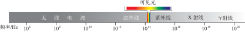

# 电磁波及其应用

电磁波是我们现代信息社会的基石——从收音机里的广播节目，到手机上的视频通话，再到卫星导航和光纤宽带，电磁波已经渗透到生活的方方面面。这一章将带你认识电磁波的基本特性，了解广播、电视、移动通信、卫星通信和光纤通信是如何利用电磁波来传递信息的。

:::: grid 3

::: card title="电磁波"
变化的电流在空间中产生电磁波，真空中以光速传播。从无线电波到 γ 射线，电磁波谱涵盖了广阔的频率范围。
:::

::: card title="广播、电视和移动通信"
无线电广播、电视和手机通信都利用电磁波来传输信息。调制与解调是信号传输的关键技术。
:::

::: card title="卫星通信和光纤通信"
通信卫星覆盖全球，光纤利用光的全反射实现高速传输——它们是现代远距离通信的两大支柱。
:::

::::

## 电磁波

### 电磁波的产生

**电磁波**（electromagnetic wave）是**变化的电流**（振荡电流）在空间中产生的。当导体中有迅速变化的电流（振荡电流）时，导线周围就会产生向周围空间传播的电磁波。

::: info 电磁波与机械波的区别

机械波（如声波）的传播需要介质，而**电磁波不需要介质**——它可以在真空中传播。这就是为什么我们能从地球上接收来自太空的电磁波信号。

:::

### 电磁波的传播

电磁波在真空中的传播速度等于光速，是宇宙中最快的速度之一。

::: formula
$$
c = \lambda f
$$

- $c$：波速 —— 米/秒（m/s），真空中 $c = 3 \times 10^8\ \text{m/s}$
- $\lambda$：波长 —— 米（m）
- $f$：频率 —— 赫兹（Hz）
:::

频率的常用单位换算：

$$
1\ \text{kHz} = 10^3\ \text{Hz} \qquad
1\ \text{MHz} = 10^6\ \text{Hz} \qquad
1\ \text{GHz} = 10^9\ \text{Hz}
$$

由 $c = \lambda f$ 可知，电磁波的频率越高，波长越短。

### 电磁波谱

按照频率从低到高（波长从长到短）的顺序排列，电磁波谱包括：无线电波、微波、红外线、可见光、紫外线、X 射线和 γ 射线。

| 波段 | 频率范围 | 波长范围 | 典型应用 |
|------|---------|---------|---------|
| 无线电波 | $< 3 \times 10^9\ \text{Hz}$ | $> 0.1\ \text{m}$ | 广播、电视、通信 |
| 微波 | $3 \times 10^9 \sim 3 \times 10^{11}\ \text{Hz}$ | $1\ \text{mm} \sim 0.1\ \text{m}$ | 微波炉、雷达、卫星通信 |
| 红外线 | $3 \times 10^{11} \sim 3.8 \times 10^{14}\ \text{Hz}$ | $0.78\ \mu\text{m} \sim 1\ \text{mm}$ | 遥控器、热成像、夜视仪 |
| 可见光 | $3.8 \times 10^{14} \sim 7.9 \times 10^{14}\ \text{Hz}$ | $380\ \text{nm} \sim 780\ \text{nm}$ | 照明、光纤通信 |
| 紫外线 | $7.9 \times 10^{14} \sim 3 \times 10^{16}\ \text{Hz}$ | $10\ \text{nm} \sim 380\ \text{nm}$ | 消毒杀菌、验钞 |
| X 射线 | $3 \times 10^{16} \sim 3 \times 10^{19}\ \text{Hz}$ | $0.01\ \text{nm} \sim 10\ \text{nm}$ | 医学成像、安检 |
| γ 射线 | $> 3 \times 10^{19}\ \text{Hz}$ | $< 0.01\ \text{nm}$ | 医疗放疗、金属探伤 |

## 广播、电视和移动通信

### 无线电广播

无线电广播利用**电磁波**将声音信号传递到远方。其基本过程如下：

1. **声音信号转换为电信号**：麦克风（话筒）将声音的振动转换为变化的电流——**音频电信号**
2. **调制**：将音频电信号加载到高频振荡电流（**载波**）上，产生**调制信号**
3. **发射**：调制后的信号通过天线向外发射电磁波
4. **接收**：收音机的天线接收空间中的电磁波，产生感应电流
5. **解调**：从调制信号中分离出音频电信号
6. **还原声音**：扬声器将音频电信号转换为声音

调制有两种基本方式：

| 调制方式 | 英文 | 特点 | 音质 | 应用 |
|---------|------|------|------|------|
| **调幅** | AM（Amplitude Modulation） | 使载波的振幅随音频信号变化 | 一般，易受干扰 | 中波广播（530~1600 kHz） |
| **调频** | FM（Frequency Modulation） | 使载波的频率随音频信号变化 | 好，抗干扰强 | 调频广播（88~108 MHz） |

### 电视信号

电视同时传输**图像**和**声音**两种信号：

- **图像信号**：通过摄像机将图像转换为电信号，发射机把电信号加载到频率很高的电流上，通过发射天线发射到空中
- **声音信号**：与广播类似，采用调频（FM）方式加载到载波上

### 移动通信

**移动通信**（mobile communication）是指通信双方至少有一方在运动中的通信方式，手机是最常见的移动通信终端。

移动通信的核心架构：

- **基站**（base station）：每个基站在其覆盖区域内负责与手机通信，覆盖区域称为一个**小区**（cell）
- **切换**（handover）：当手机从一个小区移动到另一个小区时，基站之间自动完成信号交接
- **核心网络**：基站通过光纤或微波链路连接到核心网络，实现与固话网络、互联网的互通

从 1G 到 5G，移动通信技术不断演进：

| 代 | 代表技术 | 主要特征 |
|----|---------|---------|
| 1G | AMPS、TACS | 模拟语音通话 |
| 2G | GSM、CDMA | 数字语音 + 短信 |
| 3G | WCDMA、CDMA2000、TD-SCDMA | 移动互联网 |
| 4G | LTE | 高速移动宽带 |
| 5G | NR（New Radio） | 低延迟、大连接、高速率 |

## 卫星通信和光纤通信

### 卫星通信

**卫星通信**利用人造地球卫星作为中继站来转发无线电信号，实现远距离通信。

有些通信卫星位于**地球同步轨道**（geostationary orbit），距地面约 36,000 km。在同步轨道上，卫星绕地球公转的周期与地球自转周期相同（24 小时），因此从地面看卫星是"静止"的。

一颗同步卫星可以覆盖约 **1/3** 的地球表面，**三颗**同步卫星即可覆盖除两极外的全球区域。

卫星通信的优缺点：

| 优点 | 缺点 |
|------|------|
| 覆盖范围广，可实现跨洋通信 | 发射成本高 |
| 不受地面灾害影响 | 信号延迟较大（约 0.24 s） |
| 可同时传输大量信息 | 受天气影响（雨衰） |
| 可实现广播式传输 | 轨道资源有限 |

应用领域：电视广播、电话通信、导航定位（GPS、北斗）、互联网接入、气象观测。

### 光纤通信

**光纤通信**是利用**光**在光纤中传播来传递信息的通信方式。光是频率极高的电磁波，因此光纤通信本质上也属于电磁波通信。

**光纤的结构**：

- **纤芯**（core）：光导纤维的中心部分，折射率高
- **包层**（cladding）：包裹纤芯的外层，折射率低
- **涂覆层**（coating）：保护光纤的塑料层

**工作原理——全反射**：

当光从纤芯射向包层时，如果入射角大于**临界角**，就会发生**全反射**（total internal reflection），光被完全反射回纤芯。光线在纤芯中通过反复的全反射向前传播。

光纤通信的显著优势：

| 特点 | 说明 |
|------|------|
| 传输容量大 | 一根光纤可同时传输数百万路电话或数千套电视节目 |
| 传输损耗小 | 中继距离长（可达数十公里甚至上百公里） |
| 抗电磁干扰 | 光信号不受外界电磁场的干扰 |
| 保密性好 | 光信号不易被窃听 |
| 节省资源 | 主要材料是二氧化硅（石英），资源丰富 |

光纤通信已广泛用于互联网骨干网、电视信号传输、电话通信和局域网互联等领域。

## 速记

::: card

- **电磁波**：变化的电流（振荡电流）产生电磁波，真空中传播速度 $c = 3 \times 10^8\ \text{m/s}$
- **波长频率关系**：$c = \lambda f$，频率越高波长越短
- **电磁波谱**（频率从低到高）：无线电波 → 微波 → 红外线 → 可见光 → 紫外线 → X 射线 → γ 射线
- **调制**：将信息加载到载波上；**调幅（AM）**改变振幅，**调频（FM）**改变频率
- **移动通信**：手机通过基站接入网络，小区间自动切换
- **卫星通信**：地球同步轨道卫星，三颗即可覆盖全球
- **光纤通信**：利用光的全反射原理，容量大、损耗小、抗干扰

:::
