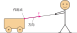
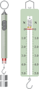
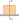

# 力

力是物理学的核心概念之一，也是后续学习压强、浮力、简单机械和功的基础。这一章围绕**力的作用效果**展开，先认识什么是力、如何描述力，再研究两种最常见的力：**弹力**和**重力**。

:::: grid 3
::: card title="力"
力是物体对物体的作用。力的作用效果是改变物体的形状或改变物体的运动状态。
:::

::: card title="弹力"
物体发生弹性形变时产生的力。弹簧测力计是测量力的大小的工具。
:::

::: card title="重力"
由于地球的吸引而使物体受到的力。重力的大小与质量成正比：$G = mg$。
:::

::::

## 力 (force)

### 力的定义

::: info 力的定义
力是**物体对物体的作用**，用符号 $F$ 表示。
:::

力的概念中需要注意：

- 力**不能脱离物体**而存在：一个物体是施力物体，另一个是受力物体
- 单独的物体不能产生力，必须有两个或两个以上的物体
- 物体之间不一定要直接接触才能产生力（如磁力、重力）

### 力的作用效果

力作用在物体上会产生两种效果：

1. **改变物体的形状**（使物体发生形变）
2. **改变物体的运动状态**（使物体的速度大小或方向发生变化）

::: tip 怎样判断运动状态是否改变
运动状态的改变包括：由静到动、由动到静、由快到慢、由慢到快、运动方向改变。只要满足其中任意一条，就说明运动状态发生了改变。
:::

### 力的三要素

力的大小、方向和作用点叫做力的**三要素**。它们会影响力的作用效果。

| 要素 | 说明 | 示例 |
| :--- | :--- | :--- |
| **大小** | 力有大小，用弹簧测力计测量；单位为牛顿（N） | 托起两个鸡蛋的力约为 $1\ \text{N}$ |
| **方向** | 力是有方向的量 | 推、拉、提、压都可以是不同的方向 |
| **作用点** | 力在物体上的作用位置 | 对同一个物体上不同位置施力，效果不同 |

### 力的示意图

::: info 力的示意图
用一根带箭头的线段来表示力，这种方法叫做**力的示意图**。

- 线段**起点**表示力的作用点
- 线段**长度**表示力的大小
- 线段**箭头**表示力的方向
:::

### 力的作用是相互的

::: info 力的相互性
当一个物体对另一个物体施加力时，另一个物体也同时对它施加力的作用。这两个力大小相等、方向相反、作用在同一直线上，分别作用在两个不同的物体上。
:::

- 甲对乙施力，乙同时对甲施力
- 施力物体同时也一定是受力物体
- 两个力同时产生、同时消失
- 生活中常见的现象：拍桌子手会疼、划船时桨向后推水船向前走、火箭向下喷气向上升空

**作用力与反作用力的互动演示**

拖动滑块，观察手推墙时，作用力与反作用力的大小和方向关系。

<Newton3rdLaw />

## 弹力 (elastic force)

### 弹性与塑性

| 概念 | 定义 | 示例 |
| :--- | :--- | :--- |
| **弹性** | 物体受力时发生形变，撤去力后能恢复原状的性质 | 弹簧、橡皮筋、气球 |
| **塑性** | 物体受力时发生形变，撤去力后不能自动恢复原状的性质 | 橡皮泥、面团、湿泥土 |

### 弹力的定义

::: info 弹力
物体由于发生**弹性形变**而产生的力叫做**弹力**。
:::

弹力的产生条件：

1. 两个物体相互**接触**
2. 物体发生了**弹性形变**

常见的弹力包括：支持力、压力、拉力、推力等。

::: tip 弹力的方向
弹力的方向与物体形变的方向相反。例如：

- 绳子对物体的拉力方向：沿绳子指向绳子收缩的方向
- 支持力的方向：垂直于接触面指向被支持的物体
- 压力的方向：垂直于接触面指向被压的物体
:::

### 弹簧测力计

弹簧测力计是测量力大小的常用工具，它的原理是：在弹性限度内，弹簧的伸长量与受到的拉力成正比。

:::: grid sidebar-left card

::: grid-item

:::

::: grid-item
**使用方法**

1. **看**：观察量程和分度值
2. **调**：调零（使指针指在零刻度线）
3. **测**：使弹簧测力计内的弹簧轴线方向跟所测力的方向在同一条直线上
4. **读**：视线与刻度盘垂直
:::

::::

::: tip 弹簧测力计使用注意事项
- 不能超过弹簧测力计的量程
- 弹簧、挂钩、指针不能与外壳摩擦
- 读数时，指针稳定后再读
:::

## 重力 (gravity)

### 重力的定义

::: info 重力
由于**地球的吸引**而使物体受到的力叫做**重力**，通常用符号 $G$ 表示。重力的施力物体是**地球**。
:::

- 地球上的所有物体都受到重力
- 重力是由于地球的吸引产生的，但重力并不等于地球对物体的引力（因为地球在自转）

### 重力的大小

物体所受的重力跟它的质量成正比。

::: formula
$$
G = mg
$$

- $G$：重力（$\text{N}$）
- $m$：质量（$\text{kg}$）
- $g$：重力加速度，$g = 9.8\ \text{N/kg}$
:::

在粗略计算时，$g$ 可以取 $10\ \text{N/kg}$。

::: info 不同地点的 g 值
在地球上不同位置，$g$ 的值略有不同：

- 赤道附近 $g$ 较小
- 两极附近 $g$ 较大
:::

### 重力的方向

::: info 重力的方向
重力的方向总是**竖直向下**的。
:::

**竖直向下**并不等同于**垂直向下**或指向地心。准确地说，重力的方向大致指向地心（但并不严格指向地心），通常称为"竖直向下"。

**竖直**方向和**水平**方向总是垂直的。

应用：铅垂线（重垂线）—— 用来检验墙壁是否竖直。

### 重心

::: info 重心的定义
地球吸引物体的每个部分。但是，对于整个物体，重力作用的表现就好像它作用在某一个点上，这个点叫作物体的**重心** (center of gravity)。
:::

生活中我们看一个物体的重心时，会注意到：

- 形状规则、质量分布均匀的物体，重心在它的**几何中心**
- 物体的重心**不一定**在物体上（如圆环的重心在环心处）
- 重心越低，物体越稳定

:::: grid sidebar-left card

::: grid-item

:::

::: grid-item
为了研究问题的方便，在受力物体上画力的示意图时，常把力的作用点画在重心上
:::

::::

### 重力与质量的区别

| 比较项 | 质量 | 重力 |
| :--- | :--- | :--- |
| 概念 | 物体所含物质的多少 | 由于地球吸引而使物体受到的力 |
| 符号 | $m$ | $G$ |
| 单位 | 千克（kg） | 牛顿（N） |
| 测量工具 | 天平 | 弹簧测力计 |
| 性质 | 标量，只有大小 | 矢量，有大小和方向 |
| 影响因素 | 不随位置改变 | 随地理位置改变 |

## 实验探究

### 来自 PhET 的在线仿真实验

[力和运动](./phet-forces-and-motion)

访问 [PhET 网站](https://phet.colorado.edu/) 查看所有在线仿真实验

## 速记

::: card

- **力**：物体对物体的作用，有大小、方向、作用点三要素
- **力的作用效果**：改变形状、改变运动状态
- **力的相互性**：施力物体同时也是受力物体
- **弹力**：物体发生弹性形变时产生的力
- **重力**：$G=mg$，方向竖直向下，作用点在重心
- **重心**：形状规则均匀物体的重心在几何中心

:::
