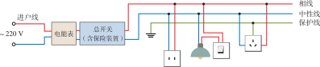
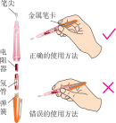

# 生活用电

电学知识不仅存在于书本和实验中，更与我们的日常生活息息相关。本章将带你走进家庭电路的世界，了解家庭电路的组成、认识测电笔这一实用工具，并掌握安全用电的基本常识。

:::: grid 2

::: card title="家庭电路"
进户线、电能表、总开关、保险装置、漏电保护器、插座、用电器——家庭电路是如何构成的？
:::

::: card title="安全用电"
触电是如何发生的？如何安全用电、避免危险？掌握这些知识保护自己。
:::

::::

## 家庭电路

### 进户线

家庭电路的两条进户线中，一条叫作**相线**（L，Live Wire），俗称火线；另一条叫作**中性线**（N，Neutral Wire），俗称零线。火线与零线之间的电压为 **220 V**，火线与大地之间的电压也为 220 V，而零线与大地之间电压通常为 0 V。

| 名称 | 符号 | 对地电压 |
|------|------|---------|
| 火线 | L | 220 V |
| 零线 | N | 0 V |

### 家庭电路的组成

家庭电路由进户线开始，依次连接**电能表**、**总开关**、**保险装置**，然后接入**插座**和**用电器**。

#### 电能表

**电能表**（电度表）安装在家庭电路的干路上，用来计量家庭消耗的电能。电能表上标有额定电压和额定电流等参数，例如"220 V 10(20) A"表示额定电压 220 V，标定电流 10 A，最大电流 20 A。

#### 总开关

**总开关**（闸刀开关）控制整个家庭电路的通断。维修电路时，必须先断开总开关，切断电源。

#### 保险装置

传统的**保险丝**（熔断器）串联在火线上。当电路中电流过大时，保险丝发热熔断，自动切断电路，起到保护作用。保险丝由**电阻率大、熔点低**的铅锑合金制成。

::: warning 警告

**严禁用铜丝、铁丝等代替保险丝！** 铜丝、铁丝在电流过大时不易熔断，起不到保护作用，可能引发火灾。

:::

现代家庭电路中，保险丝多已被**空气开关**（空气断路器）取代。空气开关在电流过大时会自动跳闸，排除故障后合闸即可恢复供电。

#### 漏电保护器

**漏电保护器**（Residual Current Device, RCD）是一种在发生漏电时自动切断电路的保护装置。当用电器外壳漏电或有人触电时，火线与零线中的电流不再相等，漏电保护器检测到这一差值（通常超过 **30 mA**）后会在极短时间内（约 0.1 s）跳闸断电。

漏电保护器常与空气开关组合成**漏电保护断路器**（RCBO），兼具过流保护和漏电保护功能。家庭装修时，通常总开关处安装漏电保护器，或各分支回路分别安装。

::: info 漏电保护器的测试

漏电保护器面板上设有**测试按钮**（标有"T"或"测试"），建议每月按下测试按钮检查漏电保护器是否工作正常。按下后应立刻跳闸断电，若未跳闸则说明漏电保护器已失效，需要更换。

:::

#### 插座

家用插座分为**两孔插座**和**三孔插座**：

| 类型 | 接法 | 说明 |
|------|------|------|
| 两孔插座 | 左零右火 | 适用于不需要接地的用电器 |
| 三孔插座 | 左零右火上接地 | 上方孔接地线，适用于带金属外壳的用电器 |

::: info 三孔插座地线

三孔插座的上方孔连接**地线**（PE，Protective Earth）。当有金属外壳的用电器漏电时，电流会通过地线导入大地，避免人体触电。

:::

#### 用电器

家庭电路中各用电器（电灯、电视、冰箱、空调等）之间**并联**连接，这样每个用电器都能在 220 V 的额定电压下独立工作，互不影响。控制用电器的开关要接在**火线上**，这样断开开关后，用电器与火线断开，维修时更安全。

### 相线和中性线的辨别

**测电笔**是用来辨别火线和零线的工具，也可用于判断低压电气设备是否带电。

测电笔由**笔尖金属体**、**高电阻**、**氖管**、**弹簧**和**笔尾金属体**组成。

**使用方法**

1. 手接触**笔尾**的**金属体**
2. 笔尖接触待测的**电线**（或插孔）
3. 如果**氖管发光**，说明接触的是**火线**
4. 如果氖管不发光，说明接触的是**零线**

::: warning 注意事项

- 使用前先在有电的地方验证测电笔是否完好
- **手千万不能接触笔尖的金属体**，否则会发生触电事故
- 测电笔中的高电阻阻值很大（约 $1 \sim 2\ \text{M}\Omega$），确保通过人体的电流极小，但测电笔一旦损坏或受潮，切勿继续使用

:::

## 安全用电

### 避免触电

#### 触电类型

触电是电流通过人体造成的伤害。常见的触电方式有：

- **单线触电**：人体接触到火线，同时站在地面上，电流经火线→人体→大地形成回路
- **双线触电**：人体同时接触到火线和零线，电流经火线→人体→零线形成回路

::: info 安全电压

不高于 **36 V** 的电压对人体是安全的。但在潮湿环境中，安全电压更低（不高于 12 V）。

:::

#### 安全用电原则

1. **不接触**低压带电体（安全电压以下除外）
2. **不靠近**高压带电体（高压电弧触电和跨步电压触电）
3. 开关要接在**火线**上，断开开关后用电设备不带电
4. 有金属外壳的用电器要**接地**
5. 不用湿手触摸开关和用电器，不在电线上晾晒衣物
6. 绝缘层破损的电线要及时更换

#### 触电急救

发现有人触电时：

1. **立即切断电源**（断开总开关或拔下插头）
2. 如果无法切断电源，用**干燥的木棒、竹竿**等绝缘物挑开电线
3. **不能直接用手去拉触电者**，否则施救者也会触电
4. 对触电者进行急救，并尽快拨打急救电话

### 防止电气火灾

电气火灾是由电路故障引发的火灾，是家庭火灾的主要原因之一。

#### 常见原因

- **过载**：同一线路上接入过多大功率用电器，导致电流超过线路额定容量，导线过热
- **短路**：火线和零线直接接触，电流剧增，产生大量热
- **接触不良**：插座、开关内部接线松动，接触电阻增大，局部过热
- **绝缘老化**：电线绝缘层破损或老化，漏电或短路引燃可燃物

#### 预防措施

1. 同一插座上不要接入过多的大功率用电器，避免过载
2. **严禁用铜丝、铁丝代替保险丝**，保险丝熔断后应查明原因再更换同规格的保险丝
3. 使用有 3C 认证的合格电器产品，不购买劣质电器
4. 定期检查家中电线的绝缘状况，老化和破损的电线及时更换
5. 大功率用电器（如空调、电暖器）应使用专用插座，不要通过接线板转接
6. 电暖器、电热毯等取暖设备远离易燃物（窗帘、床单等），人离开时关闭电源
7. 厨房、卫生间的插座应安装**防溅盒**，防止水汽进入导致短路

## 速记

::: card

- **家庭电路**：进户线（火线 220 V、零线 0 V）→ 电能表 → 总开关 → 保险装置 → 漏电保护器 → 插座/用电器
- **插座接法**：左零右火上接地；开关接火线
- **并联**：各用电器之间并联，互不影响
- **测电笔**：手触笔尾金属体，笔尖接触电线，氖管发光为火线
- **保险丝**：电阻率大、熔点低；**严禁用铜丝、铁丝代替**
- **安全电压**：不高于 36 V
- **安全用电**：不接触低压带电体，不靠近高压带电体；避免过载和短路，防止电气火灾

:::
