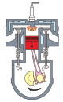

# 内能及其利用

内能是物体内部所有分子热运动的能量。从烧水做饭到汽车发动机，从一杯热水的冷却到整个宇宙的能量守恒——内能及其转化与利用无处不在。

:::: grid 3

::: card title="分子动理论"
物质由大量分子构成，分子在不停地做无规则热运动，分子间存在相互作用的引力和斥力。
:::

::: card title="内能"
物体内部所有分子热运动的动能与分子势能的总和叫内能。做功和热传递可以改变物体的内能。
:::

::: card title="比热容"
比热容是反映物质吸热能力的物理量。水的比热容较大，在生活和生产中有着广泛的应用。
:::

::::

## 分子动理论

### 物质的构成

常见的物质是由极其微小的粒子——**分子** (molecule) 和**原子** (atom) 构成的。分子很小，一般分子的直径只有 $10^{-10}\:\mathrm{m}$ 量级。物体含有的分子数目非常巨大。

### 分子热运动

#### 扩散现象

不同的物质在互相接触时彼此进入对方的现象，叫做**扩散** (diffusion)。

**气体扩散实验**：装着红棕色二氧化氮气体的瓶子与装有空气的瓶子连通后，两瓶气体逐渐混合均匀，颜色变得相同。这说明气体分子在不停地运动。

::: info 扩散现象
- **气体**可以发生扩散（如二氧化氮在空气中的扩散）
- **液体**也可以发生扩散（如把墨水滴入水中，墨水逐渐扩散开）
- **固体**同样能发生扩散（如铅片和金片紧压在一起，几年后彼此渗入）
:::

**影响扩散快慢的因素**

扩散的快慢与**温度**有关。温度越高，扩散越快。

#### 热运动

::: tip 热运动
扩散现象等大量事实表明：**一切物质的分子都在不停地做无规则的运动**。这种无规则的运动叫作分子的**热运动** (thermal motion)。分子运动越剧烈，物体的温度越高。
:::

### 分子间的作用力

分子间同时存在**引力**和**斥力**。

| 距离范围 | 主导作用 | 表现 |
| :--- | :--- | :--- |
| 分子间距离很小（$r < r_0$） | 斥力为主 | 固体和液体很难被压缩 |
| 分子间距离平衡（$r = r_0$） | 引力 = 斥力 | 分子处于平衡位置 |
| 分子间距离较大（$r > r_0$） | 引力为主 | 固体有一定的形状，液体保持一定体积 |
| 分子间距离很大（$r \gg r_0$） | 作用力可忽略 | 气体分子间几乎无相互作用 |

::: tip 分子动理论的基本内容
分子动理论的基本内容可以概括为：
1. 物质是由**分子**和**原子**构成的
2. 分子在不停地做**无规则热运动**
3. 分子间存在**相互作用的引力和斥力**
:::

## 内能

### 内能的概念

物体内部所有分子热运动的**动能**与分子**势能**的总和，叫作物体的**内能** (internal energy)。

- 分子动能：分子由于做热运动而具有的能。温度越高，分子热运动越剧烈，分子动能越大。
- 分子势能：由于分子间存在引力和斥力，分子间具有的势能。分子间距离变化时，分子势能发生变化。

::: info 关于内能
内能的单位是**焦耳** (J)。一切物体，不论温度高低，都具有内能。即使是 0℃ 的冰，其分子也在做热运动，也具有内能。
:::

### 影响内能大小的因素

1. **温度**：同一物体，温度越高，分子热运动越剧烈，内能越大
2. **质量**：同种物质，温度相同时，质量越大，分子数目越多，内能越大
3. **状态**：同种物质，温度相同，状态不同（如冰和水），分子间距离不同，分子势能不同，内能也不同
4. **种类**：不同物质的分子结构不同，内能也不同

### 改变内能的两种方式

#### 做功

对物体做功，物体的内能**增大**；物体对外做功，内能**减小**。

::: card title="做功改变内能的实例"
- **搓手取暖**：双手互相摩擦，克服摩擦力做功，手的内能增加，温度升高
- **钻木取火**：克服摩擦力做功，使木头的内能增加，温度升高到着火点
- **压缩空气引火**：快速压缩活塞，对气体做功，气体的内能增加，温度升高，使棉花燃烧
- **气体膨胀做功**：水蒸气对壶盖做功，内能减小，温度降低
:::

#### 热传递

**热传递** (heat transfer) 是热量从温度高的物体传递到温度低的物体的过程。热传递的三种方式：**传导**、**对流**、**辐射**。

在热传递过程中，传递的能量的多少叫作**热量** (heat)，用 $Q$ 表示，单位是焦耳 (J)。

- 物体**吸热**，内能**增大**
- 物体**放热**，内能**减小**

::: tip 做功和热传递的对比
**做功**和**热传递**在改变物体的内能上是**等效**的。但它们本质不同：做功的本质是**能量的转化**（机械能与内能相互转化）；热传递的本质是**能量的转移**（内能从高温物体转移到低温物体）。
:::

## 比热容

### 比热容的概念

某种物质温度升高（或降低）所吸收（或放出）的热量，与其质量和温度变化量乘积之比，叫作这种物质的**比热容** (specific heat capacity)，用 $c$ 表示。

**比热容的定义式**：

::: formula
$$
c = \frac{Q}{m\Delta t}
$$

其中 $c$ 为比热容，$Q$ 为吸收的热量，$m$ 为质量，$\Delta t$ 为升高的温度。
:::

**比热容的单位**：焦耳每千克摄氏度，符号为 $\mathrm{J/(kg \cdot {}^\circ C)}$

| 物质 | 比热容 $c\:/ \mathrm{J\cdot (kg\cdot {}^\circ C)^{-1}}$ |
| :--- | :--- |
| 水 | $4.2 \times 10^3$ |
| 冰 | $2.1 \times 10^3$ |
| 酒精 | $2.4 \times 10^3$ |
| 煤油 | $2.1 \times 10^3$ |
| 砂石 | $0.92 \times 10^3$ |
| 干泥土 | $0.84 \times 10^3$ |
| 铁、钢 | $0.46 \times 10^3$ |
| 铜 | $0.39 \times 10^3$ |
| 水银 | $0.14 \times 10^3$ |

::: info 理解比热容
比热容是物质的一种**特性**，只与物质的**种类**和**状态**有关，与物体的质量、升高的温度、吸收的热量无关。
:::

### 热量的计算

根据比热容的定义式，可以推导出热量计算公式：

::: formula
$$
Q = cm\Delta t
$$

其中 $Q$ 为吸收或放出的热量（单位：J），$c$ 为比热容，$m$ 为质量，$\Delta t$ 为温度变化量。
:::

- 物体**吸热**：$Q_{吸} = cm(t - t_0)$，其中 $t$ 为末温，$t_0$ 为初温
- 物体**放热**：$Q_{放} = cm(t_0 - t)$

### 水的比热容的特点及其应用

水的比热容在常见的物质中**最大**，这使水在生活和生产中有着重要的应用：

::: card title="水的比热容大的影响和应用"
- **暖气用水作介质**：水的比热容大，降低相同温度时放出的热量更多
- **发动机用水冷却**：水的比热容大，升高相同温度时吸收的热量更多，冷却效果好
- **沿海地区昼夜温差小**：水的比热容比砂石大得多，白天吸收相同热量时，水的温度升高得少；夜晚放出相同热量时，水的温度降低得少
:::

## 热机

### 热机的工作原理

**热机** (heat engine) 是将内能转化为机械能的装置。

热机的工作原理：燃料燃烧释放的**化学能**转化为**内能**，内能再通过做功转化为**机械能**。

常见的热机有：**蒸汽机**、**内燃机**（汽油机、柴油机）、**燃气轮机**、**喷气发动机**等。

### 汽油机

汽油机是常用的内燃机之一，它的工作过程由**四个冲程**组成：

:::: grid 2

::: card

**吸气冲程**：进气门打开，排气门关闭，活塞向下运动，汽油和空气的混合物被吸入气缸。
:::

::: card

**压缩冲程**：进气门和排气门都关闭，活塞向上运动，燃料混合物被压缩，温度升高。此冲程中，**机械能转化为内能**。
:::

::: card

**做功冲程**：压缩冲程结束时，火花塞产生电火花，使燃料猛烈燃烧，产生高温高压的气体。高温高压的气体推动活塞向下运动，带动曲轴转动，对外做功。此冲程中，**内能转化为机械能**。
:::

::: card

**排气冲程**：进气门保持关闭，排气门打开，活塞向上运动，把废气排出气缸。
:::

::::

::: tip 四冲程要点
汽油机的一个工作循环包括**四个冲程**（吸气、压缩、做功、排气），活塞往复**两次**，曲轴转动**两周**，对外做功**一次**。其中只有**做功冲程**对外提供动力，其他三个冲程依靠飞轮的**惯性**来完成。
:::

### 柴油机

柴油机与汽油机的区别：

| 比较项 | 汽油机 | 柴油机 |
| :--- | :--- | :--- |
| 燃料 | 汽油 | 柴油 |
| 吸气冲程吸入 | 汽油和空气的混合物 | 纯空气 |
| 点火方式 | **点燃式**（火花塞点火） | **压燃式**（压缩空气使温度升高，喷入柴油后自行燃烧） |
| 压缩程度 | 压缩程度较小 | 压缩程度较大 |
| 效率 | 较低（$20\% \sim 30\%$） | 较高（$30\% \sim 45\%$） |
| 用途 | 小汽车、摩托车等 | 载重汽车、拖拉机、火车、轮船等 |

### 燃料的热值

**热值** (calorific value) 是燃料的一种特性：某种燃料**完全燃烧**放出的热量与其质量之比，叫作这种燃料的热值，用 $q$ 表示。

::: formula
$$
q = \frac{Q}{m}
$$

其中 $q$ 为热值（单位：$\mathrm{J/kg}$），$Q$ 为完全燃烧放出的热量，$m$ 为燃料的质量。
:::

热值反映燃料**释放热量**的能力，是燃料本身的一种特性，只与燃料的**种类**有关。

常见燃料的热值：

| 燃料 | 热值 $q\:/ \mathrm{J\cdot kg^{-1}}$ |
| :--- | :--- |
| 干木柴 | 约 $1.2 \times 10^7$ |
| 烟煤 | 约 $2.9 \times 10^7$ |
| 无烟煤 | 约 $3.4 \times 10^7$ |
| 汽油 | $4.6 \times 10^7$ |
| 柴油 | $4.3 \times 10^7$ |
| 氢 | $1.4 \times 10^8$ |
| 天然气 | 约 $4.4 \times 10^7\:\mathrm{J/m^3}$ |

燃料完全燃烧放出的热量计算公式：

::: formula
$$
Q = mq
$$

$m$ 为质量，$q$ 为热值。对于气体燃料，常用 $V$ 表示体积，$Q = Vq$。
:::

### 热机效率

热机工作时，用来做**有用功**的那部分能量与燃料**完全燃烧**放出的能量之比，叫作热机的**效率** (efficiency)。

::: formula
$$
\eta = \frac{W_{有用}}{Q_{放}} \times 100\%
$$
:::

::: info 关于热机效率
- 热机效率**总小于 1**（因为燃料很难完全燃烧，而且燃烧放出的能量不可能全部转化为有用机械能）
- 提高热机效率的途径：使燃料充分燃烧；减少热损失；减少机械摩擦
:::

## 能量的转化与守恒

### 能量守恒定律

**能量既不会凭空消灭，也不会凭空产生，它只会从一种形式转化为其他形式，或者从一个物体转移到其他物体，而在转化和转移的过程中，能量的总量保持不变。**

这就是**能量守恒定律** (law of conservation of energy)，它是自然界最重要、最普遍的基本定律之一。

::: card title="各种形式的能量"
- **机械能**：动能、重力势能、弹性势能
- **内能**：与分子热运动相关的能量
- **电能**：与电荷运动和电场相关的能量
- **化学能**：储存在化学物质中的能量（如燃料、食物）
- **光能**：光具有的能量（如太阳能）
- **核能**：原子核内部储存的能量
:::

**能量转化的实例**

| 实例 | 能量转化 |
| :--- | :--- |
| 摩擦生热 | 机械能 → 内能 |
| 电灯发光 | 电能 → 光能 |
| 光合作用 | 光能 → 化学能 |
| 发电机发电 | 机械能 → 电能 |
| 电动机转动 | 电能 → 机械能 |
| 燃料燃烧 | 化学能 → 内能 |
| 太阳能电池 | 光能 → 电能 |
| 电池充电 | 电能 → 化学能 |

### 能量转化和转移的方向性

能量的转化和转移具有**方向性**：

- 内能**只能自发地**从高温物体转移到低温物体，不能相反
- 机械能可以**全部**转化为内能，内能**不能全部**转化为机械能（热机的效率总小于 100%）

::: warning 启示
能量守恒定律告诉我们能量总量保持不变，但能量的转化和转移具有方向性。因此，**节约能源**仍然是我们必须坚持的原则。
:::

## 实验探究

### 来自 PhET 的在线仿真实验

- [气体扩散仿真实验](./phet-diffusion) — 观察气体分子的扩散运动，理解分子热运动与温度的关系
- [原子的相互作用仿真实验](./phet-atomic-interactions) — 观察原子间的引力和斥力，理解分子间作用力的本质
- [摩擦生热仿真实验](./phet-friction) — 观察摩擦力做功使物体内能增加的现象，理解做功改变内能
- [能量的形式和转换仿真实验](./phet-energy-forms) — 探究不同形式能量的相互转化，理解能量守恒定律

访问 [PhET 网站](https://phet.colorado.edu/zh_CN/) 查看所有在线仿真实验

## 速记

::: card

- **分子动理论三要点**：物质由分子构成、分子不停做无规则热运动、分子间有引力和斥力。
- **扩散现象**：不同物质互相接触时彼此进入对方，温度越高扩散越快。
- **内能**：物体内部所有分子动能与分子势能的总和。一切物体都有内能。
- **改变内能的方式**：做功（能量转化）和热传递（能量转移），两者等效。
- **比热容**：反映物质吸热能力的特性，$Q = cm\Delta t$。
- **热机**：将内能转化为机械能的装置。汽油机四冲程（吸气→压缩→做功→排气），做功冲程提供动力。
- **能量守恒定律**：能量不会凭空产生或消失，总量保持不变，但转化和转移具有方向性。

:::
