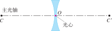
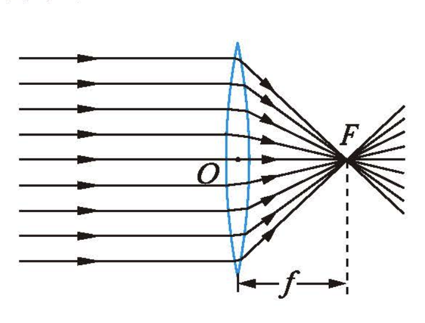
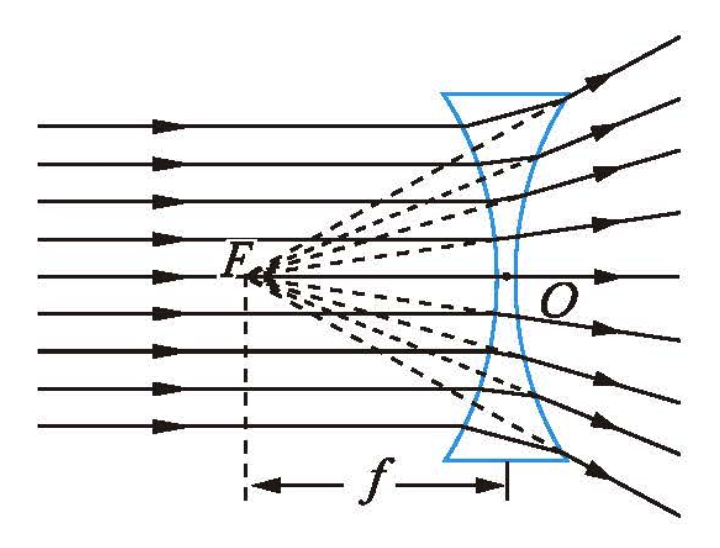
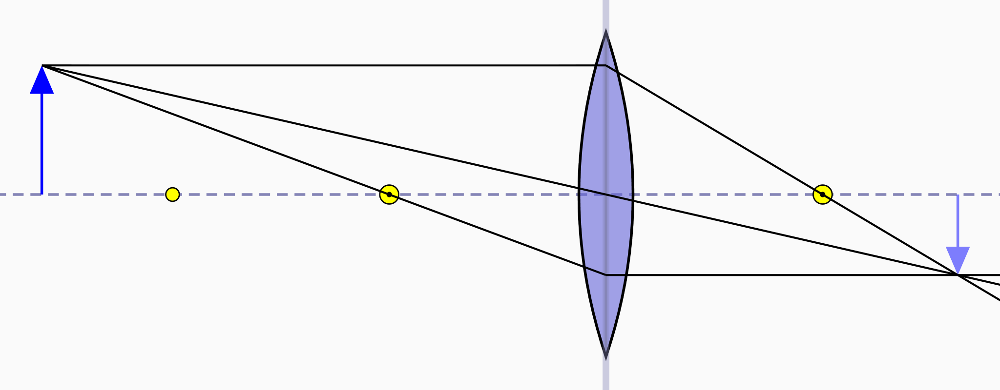
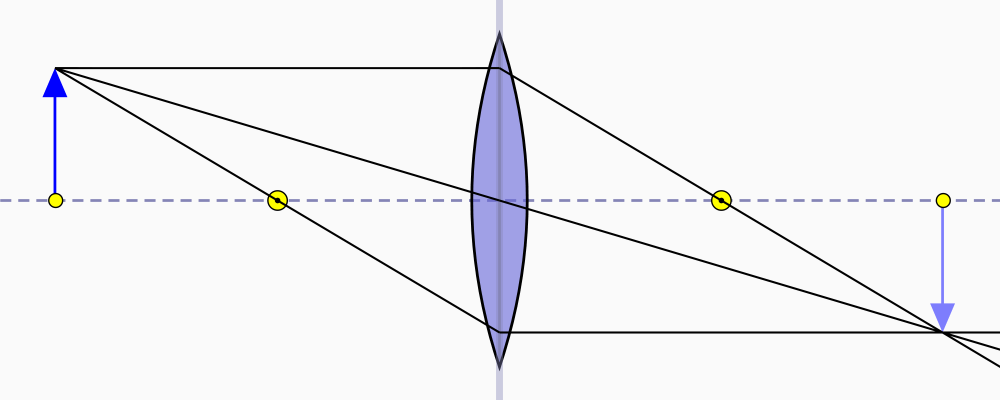
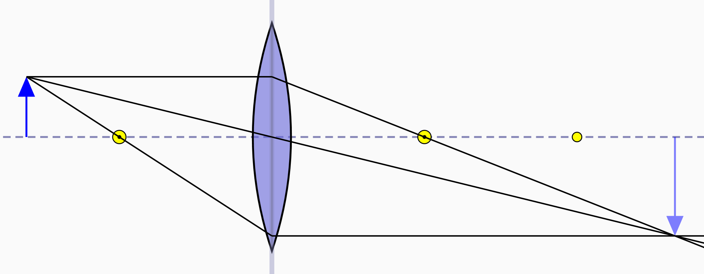
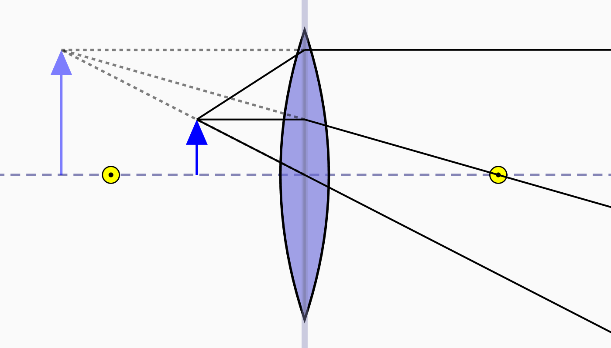
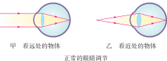
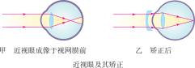
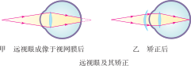

# 透镜及其应用

透镜是光学仪器中最重要的元件之一。从照相机的镜头到近视眼镜的镜片，从显微镜到望远镜——这些设备的核心都是透镜。本章将系统学习透镜的种类、成像规律以及它们在生活和科技中的应用。

::: info 透镜知识结构
本章将从透镜的基本概念开始，认识凸透镜和凹透镜的区别，然后深入学习凸透镜成像的规律及其应用，最后了解透镜在眼睛矫正、显微镜和望远镜中的重要作用。
:::

:::: grid 3

::: card title="透镜基础"
认识凸透镜和凹透镜的外观区别、主光轴、光心和焦点。凸透镜对光有会聚作用，凹透镜对光有发散作用。三条特殊光线是理解透镜成像的关键。
:::

::: card title="凸透镜成像规律"
物距变化时，像的大小、倒正和虚实随之变化。一倍焦距分虚实，二倍焦距分大小。成像规律广泛应用于照相机、投影仪和放大镜。
:::

::: card title="生活中的透镜与眼睛"
透镜不仅存在于光学仪器中——我们的眼睛就是一台精密的变焦系统。近视眼和远视眼可以通过配戴合适的透镜进行矫正。显微镜和望远镜则帮助我们探索微观和宏观世界。
:::

::::

## 透镜

### 凸透镜和凹透镜

**凸透镜** (convex lens) 中间厚、边缘薄，对光有**会聚**作用。**凹透镜** (concave lens) 中间薄、边缘厚，对光有**发散**作用。

如果透镜的厚度远小于球面的半径，这种透镜就叫作薄透镜。

| 透镜类型 | 形状特点 | 对光的作用 | 应用举例 |
| :--- | :--- | :--- | :--- |
| 凸透镜 | 中间厚、边缘薄 | 会聚 | 放大镜、照相机、远视眼镜 |
| 凹透镜 | 中间薄、边缘厚 | 发散 | 近视眼镜、门镜（猫眼） |

### 主光轴和光心

通过透镜两个球面球心的直线叫作**主光轴** (principal axis)。主光轴上有个特殊的点，通过这个点的光传播方向不变，这个点叫作透镜的**光心** (optical center)。薄透镜的光心可以认为就在透镜的中心。

::: grid 2

:::

上图分别为凸透镜和凹透镜的主光轴和光心。

### 焦点和焦距

:::: grid 2

::: card
**凸透镜**：平行于主光轴的光线通过凸透镜后会会聚于主光轴上的一点，这个点叫作**焦点** (focus)，用 $F$ 表示。焦点到光心的距离叫作**焦距** (focal length)，用 $f$ 表示。凸透镜有两个实焦点（两侧各一个）。

:::

::: card
**凹透镜**：平行于主光轴的光线通过凹透镜后发散，发散光线的反向延长线会交于主光轴上的一点，这个点叫作凹透镜的**虚焦点**（也用 $F$ 表示）。凹透镜有两个虚焦点（两侧各一个）。

:::

::::

| 透镜 | 焦点类型 | 焦点位置 |
| :--- | :--- | :--- |
| 凸透镜 | **实焦点**（光线实际会聚） | 两侧各有一个 |
| 凹透镜 | **虚焦点**（反向延长线交点） | 两侧各有一个 |

### 透镜对光的作用

- **凸透镜**对光有**会聚**作用——折射光线偏向主光轴方向
- **凹透镜**对光有**发散**作用——折射光线偏离主光轴方向

::: info 理解"会聚"和"发散"
"会聚"是指折射光线相对于入射光线更靠近主光轴（偏向主光轴方向），不一定要会聚于一点；"发散"是指折射光线相对于入射光线更远离主光轴（偏离主光轴方向）。因此，凸透镜也叫**会聚透镜**，凹透镜也叫**发散透镜**。
:::

### 三条特殊光线

掌握三条特殊光线通过透镜后的传播方向，是理解透镜成像的基础。

**凸透镜的三条特殊光线：**

1. **平行于主光轴的光线**，经凸透镜折射后**过焦点**（$F'$）
2. **过光心的光线**，传播方向**不变**
3. **过焦点的光线**（或从焦点发出的光线），经凸透镜折射后**平行于主光轴**

**凹透镜的三条特殊光线：**

1. **平行于主光轴的光线**，经凹透镜折射后发散，发散光线的反向延长线**过同侧虚焦点**（$F$）
2. **过光心的光线**，传播方向**不变**
3. **延长线过对侧虚焦点的光线**（$F'$），经凹透镜折射后**平行于主光轴**

::: tip 三条特殊光线的比较
凸透镜和凹透镜的三条特殊光线中，第一条和第三条是互逆的，第二条（过光心方向不变）是一致的。这是作图时最重要的三条光线。
:::

## 凸透镜成像的规律

### 物距(u)和像距(v)

- **物距** (object distance)：物体到透镜光心的距离，用 $u$ 表示
- **像距** (image distance)：像到透镜光心的距离，用 $v$ 表示

凸透镜成像的规律可以通过实验探究得出。成像情况取决于物距 $u$ 与透镜焦距 $f$ 的关系。

### 成像规律

| 物距（$u$） | 像的性质 | 像距（$v$） | 应用 |
| :--- | :--- | :--- | :--- |
| $u > 2f$ | 倒立、缩小的**实像** | $f < v < 2f$ | **照相机** |
| $u = 2f$ | 倒立、等大的**实像** | $v = 2f$ | 测焦距 |
| $f < u < 2f$ | 倒立、放大的**实像** | $v > 2f$ | **投影仪** |
| $u = f$ | **不成像**（折射光线平行射出） | — | 探照灯（获得平行光） |
| $u < f$ | 正立、放大的**虚像** | $v > u$（同侧） | **放大镜** |

::: formula 凸透镜成像公式

$$\frac{1}{u} + \frac{1}{v} = \frac{1}{f}$$

其中 $u$ 为物距，$v$ 为像距，$f$ 为焦距。$u = f$ 时公式无意义（不成像），$u < f$ 时 $v$ 为负值（虚像）。

:::

### 实像和虚像的区别

| 对比项 | 实像 (real image) | 虚像 (virtual image) |
| :--- | :--- | :--- |
| 形成原因 | 实际光线会聚而成 | 折射光线的反向延长线相交而成 |
| 能否呈现在光屏上 | **能** | **不能** |
| 倒立/正立 | 通常是**倒立**的 | 通常是**正立**的 |
| 与物的位置关系 | 在透镜**异侧** | 在透镜**同侧** |

### 成像规律示意图

凸透镜成像的四个关键位置对应的光路图：

**$u > 2f$ —— 倒立、缩小的实像（照相机原理）**

**$u = 2f$ —— 倒立、等大的实像（测焦距）**

**$f < u < 2f$ —— 倒立、放大的实像（投影仪原理）**

**$u < f$ —— 正立、放大的虚像（放大镜原理）**

### 在线实验

请拖动下方的滑块，观察绿色物体通过凸透镜后，橙色像的变化规律。调整物距 $u$ 和焦距 $f$，观察成像性质、像距和放大率的实时变化。

<Convex />

::: info 成像规律记忆口诀

**一倍焦距分虚实，二倍焦距分大小。**

- 一倍焦距以内成**虚像**，一倍焦距以外成**实像**——虚像正立，实像倒立
- 二倍焦距以外成**缩小**像，二倍焦距以内成**放大**像
- **实像倒立在异侧，虚像正立在同侧**
- 物近像远像变大（实像时），物远像近像变小
:::

## 生活中的透镜

### 照相机 (Camera)

照相机的镜头相当于一个**凸透镜**。拍摄时，物体到镜头的距离 $u > 2f$（在二倍焦距以外），在胶片或感光元件上形成**倒立、缩小的实像**。

> 调焦（调节镜头到胶片的距离）是为了使像清晰地呈现在胶片上。物距变化时，像距也需相应调整。

### 投影仪 (Projector)

投影仪的镜头也相当于一个**凸透镜**。投影片（物体）到镜头的距离在 $f < u < 2f$ 之间（一倍焦距和二倍焦距之间），在屏幕上形成**倒立、放大的实像**。

> 投影仪通常使用平面镜来改变光的传播方向，使像正立地投射到屏幕上。

### 放大镜 (Magnifying Glass)

放大镜是一个**凸透镜**。使用时，将物体放在 $u < f$（一倍焦距以内），通过放大镜可以看到**正立、放大的虚像**。

> 放大镜的放大效果与焦距有关：焦距越短，放大倍数越大。但如果物体离放大镜太远（$u > f$），将看不到放大的像。

### 显微镜 (Microscope)

显微镜由两个凸透镜组成：

- **物镜** (objective lens)：靠近物体，焦距**较短**。物体通过物镜成**倒立、放大的实像**（成像规律：$f < u < 2f$）
- **目镜** (eyepiece lens)：靠近眼睛，焦距**较长**。物镜所成的实像通过目镜成**正立、放大的虚像**（成像规律：$u < f$）

显微镜的放大倍数 = 物镜放大倍数 $\times$ 目镜放大倍数。

### 望远镜 (Telescope)

望远镜也由两个凸透镜组成（开普勒望远镜）：

- **物镜**：焦距**较长**。远处的物体通过物镜成**倒立、缩小的实像**（成像规律：$u > 2f$）
- **目镜**：焦距**较短**。物镜所成的实像通过目镜成**正立、放大的虚像**

::: info 显微镜与望远镜的对比
| 光学仪器 | 物镜作用 | 目镜作用 | 最终成像 |
| :--- | :--- | :--- | :--- |
| 显微镜 | 成倒立放大实像（投影仪原理） | 成正立放大虚像（放大镜原理） | 倒立放大虚像 |
| 望远镜 | 成倒立缩小实像（照相机原理） | 成正立放大虚像（放大镜原理） | 倒立缩小虚像 |
:::

## 眼睛和眼镜

### 眼睛的结构

人眼相当于一架精密的**照相机**：

- **晶状体和角膜** 相当于**凸透镜**（可调节焦距）
- **视网膜** 相当于**光屏**（胶片）

外界物体通过晶状体和角膜折射后，在视网膜上形成**倒立、缩小的实像**。视网膜上的感光细胞将光信号转化为神经信号，经视神经传给大脑，人就能看到物体了。

### 正常眼睛的调节

眼睛通过改变晶状体的形状（即改变焦距）来看清远近不同的物体，这个过程叫作**调节** (accommodation)。

- **看近处物体**：晶状体变**凸**（焦距变短），折光能力增强
- **看远处物体**：晶状体变**平**（焦距变长），折光能力减弱

正常眼睛的明视距离约为 25 cm。

### 近视眼及其矫正

**近视眼** (myopia) 的成因：

- **晶状体太厚**（折光能力太强），或**眼球前后径太长**
- 远处物体的像成在视网膜**前方**
- 看远处物体模糊不清

**矫正方法**：配戴**凹透镜**——凹透镜使光线发散后再进入眼睛，使像后移至视网膜上。

### 远视眼及其矫正

**远视眼** (hyperopia) 的成因：

- **晶状体太薄**（折光能力太弱），或**眼球前后径太短**
- 近处物体的像成在视网膜**后方**
- 看近处物体模糊不清（远视眼俗称"老花眼"）

**矫正方法**：配戴**凸透镜**——凸透镜使光线会聚后再进入眼睛，使像前移至视网膜上。

::: info 近视眼和远视眼对比
| 对比项 | 近视眼 | 远视眼 |
| :--- | :--- | :--- |
| 成因 | 晶状体太厚（折光太强）或眼球前后径太长 | 晶状体太薄（折光太弱）或眼球前后径太短 |
| 像的位置 | 成在视网膜**前方** | 成在视网膜**后方** |
| 矫正 | 配戴**凹透镜** | 配戴**凸透镜** |
| 常见人群 | 青少年（用眼过度） | 老年人（晶状体调节能力下降） |
:::

::: warning 注意
近视眼和远视眼的矫正透镜不同——近视眼戴凹透镜，远视眼戴凸透镜。千万不要混淆！可以用"近凹远凸"来记忆。
:::

## 实验探究

### 来自 PhET 的在线仿真实验

- [几何光学](./phet-geometric-optics) — 探究透镜的成像规律与光的传播，调整物距、焦距和透镜类型，观察成像变化

访问 [PhET 网站](https://phet.colorado.edu/zh_CN/) 查看所有在线仿真实验

### 射线光学模拟

[射线光学模拟](https://phydemo.app/ray-optics/cn/) - 提供丰富的几何光学模拟功能，支持多透镜组合、各种透镜和反射镜的模拟，还可以查看多种经典光学仪器的工作原理。

## 速记

::: card

- **凸透镜与凹透镜**：凸透镜中间厚边缘薄，对光有会聚作用；凹透镜中间薄边缘厚，对光有发散作用
- **三条特殊光线**：平行于主光轴 → 过焦点（或反向延长线过焦点）；过光心 → 方向不变；过焦点 → 平行于主光轴
- **凸透镜成像规律**：一倍焦距分虚实，二倍焦距分大小。实像倒立在异侧，虚像正立在同侧。物近像远像变大（实像时）
- **实像与虚像**：实像由实际光线会聚而成，能在光屏上呈现、倒立；虚像由光线的反向延长线相交而成，不能在光屏上呈现、正立
- **照相机**：$u > 2f$，成倒立缩小的实像
- **投影仪**：$f < u < 2f$，成倒立放大的实像
- **放大镜**：$u < f$，成正立放大的虚像
- **显微镜**：物镜成倒立放大实像（投影仪原理），目镜成正立放大虚像（放大镜原理）
- **望远镜**：物镜成倒立缩小实像（照相机原理），目镜成正立放大虚像（放大镜原理）
- **眼睛与矫正**：近视眼戴凹透镜（像在视网膜前方），远视眼戴凸透镜（像在视网膜后方）。**近凹远凸**

:::
