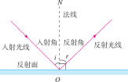
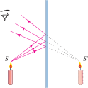
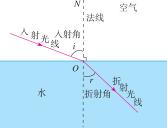
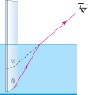

# 光现象

我们能够看到绚丽多彩的世界，是因为有光的存在。从日出的朝霞到日落的余晖，从水中的倒影到雨后的彩虹——这些美丽的光现象背后，蕴含着光的传播、反射、折射和色散等物理规律。

::: info 光学知识结构
本章将从光的传播开始，依次学习光的反射、平面镜成像、光的折射，最后了解光的色散现象。这些知识将帮助我们理解生活中各种奇妙的光学现象。
:::

:::: grid 3

::: card title="光的传播"
光在同种均匀介质中沿直线传播。通过小孔成像、影子的形成等现象，我们可以理解光的传播规律。光速是自然界中最快的速度。
:::

::: card title="光的反射与平面镜成像"
光在遇到物体表面时会发生反射。反射定律是理解光的反射和平面镜成像的基础。平面镜所成的虚像与物体关于镜面对称。
:::

::: card title="光的折射与色散"
光从一种介质斜射入另一种介质时会发生折射。白光通过三棱镜可以分解成七种颜色的光，色光的三原色是红、绿、蓝。
:::

::::

## 光的传播

### 光源

**光源** (light source) 是指**能够自行发光的物体**。

| 光源 | 举例 |
| :--- | :--- |
| 天然光源 | 太阳、萤火虫、水母 |
| 人造光源 | 电灯、蜡烛、激光 |

::: warning 注意
月亮不是光源，它本身不发光，只是反射了太阳的光。钻石看起来闪闪发光，也是因为它反射了外界的光，所以也不是光源。
:::

### 光的直线传播

光在同种均匀介质中沿**直线**传播。

为了表示光的传播情况，我们通常用一条带有箭头的直线表示一束光传播的径迹和方向。这样的直线叫作**光线** (light ray)。

**常见的光沿直线传播的现象：**

1. **影子的形成**——光在传播过程中遇到不透明的物体时，物体后方形成光线照不到的区域（影子）
2. **日食和月食**——日食是月亮挡住了太阳的光，月食是地球挡住了太阳照射到月亮上的光
3. **小孔成像**——通过小孔可以在光屏上形成倒立的实像

::: card title="小孔成像"
小孔成像实验中，物体通过小孔在光屏上形成**倒立的实像**。像的大小由物距和像距决定：

- 物距 > 像距：**缩小**的像
- 物距 = 像距：**等大**的像
- 物距 < 像距：**放大**的像

成像大小与孔的形状**无关**——孔是方的，成的像也是物体本身的形状。
:::

### 光速

光的传播速度极快。在不同介质中，光速不同：

- 在**真空**中，光速最快，约为 $3 \times 10^8 \text{m/s}$（每秒约 30 万千米）
- 在**空气**中，光速略小于真空中的光速（可近似为 $3 \times 10^8 \text{m/s}$）
- 在**水**中，光速约为真空中的 $\dfrac{3}{4}$
- 在**玻璃**中，光速约为真空中的 $\dfrac{2}{3}$

::: info 光年
**光年** (light-year) 是**距离单位**（不是时间单位），指光在真空中一年内传播的距离。

$$1 \text{光年} = 9.46 \times 10^{15} \text{m}$$

天文学中常用光年表示天体之间的距离。例如，离太阳最近的恒星（比邻星）距离地球约 4.2 光年。
:::

## 光的反射

光从一种介质射向另一种介质的表面时，会改变传播方向返回到原介质中，这就是**光的反射** (reflection)。

### 反射定律

光的反射遵循以下规律（统称为**反射定律**）：

1. **三线共面**——反射光线、入射光线和法线在**同一平面**内
2. **两线分居**——反射光线和入射光线分别位于**法线两侧**
3. **两角相等**——反射角 **等于** 入射角（$\angle r = \angle i$）

> 注意：反射角等于入射角，不能说"入射角等于反射角"，因为先有入射角后有反射角，反射角由入射角决定。

### 光路的可逆性

在反射现象中，光路是**可逆**的。如果光线沿反射光线的路径射入，它将会沿着原来入射光线的路径射出。

### 镜面反射和漫反射

| 反射类型 | 镜面反射 (specular reflection) | 漫反射 (diffuse reflection) |
| :--- | :--- | :--- |
| 反射面特点 | 光滑表面（如镜子、平静水面） | 粗糙表面（如墙壁、黑板、纸张） |
| 反射特点 | 平行光线射向光滑表面，反射光线**仍然平行** | 平行光线射向粗糙表面，反射光线**向各个方向** |
| 视觉表现 | 只能在特定方向看到反射光 | 从各个方向都能看到物体 |
| 遵循规律 | 遵循反射定律 | **同样遵循反射定律**（只是表面不平整，法线方向不同） |

::: info 漫反射使我们能看到不发光的物体
教室里，各个方向的同学都能看到黑板上的字，是因为光在粗糙的黑板表面发生了**漫反射**。我们能看到本身不发光的物体（如桌子、书本），也是因为物体表面发生了漫反射，反射光进入了我们的眼睛。
:::

## 平面镜成像

### 成像特点

平面镜成像的特点可以概括为**等大、等距、垂直、虚像**：

1. **等大**——像与物体的大小**相等**
2. **等距**——像到镜面的距离**等于**物体到镜面的距离
3. **垂直**——像与物体的连线与镜面**垂直**
4. **虚像**——平面镜成的是**虚像**（不能在光屏上呈现）

平面镜成像的规律也可以表述为：**平面镜所成的像为虚像，像与物体关于镜面对称**。

### 平面镜成像的原理

平面镜成像的原理是**光的反射**。物体发出的光经平面镜反射后进入人眼，人眼逆着反射光线的方向看过去，觉得光是从镜后的某一点发出的，这个点就是物体的虚像。

### 平面镜的应用

| 应用 | 举例 |
| :--- | :--- |
| 梳妆打扮 | 家中的穿衣镜 |
| 改变光路 | 潜望镜中的平面镜 |
| 牙科检查 | 牙医使用的平面镜 |

### 球面镜

反射⾯为球⾯的一部分的镜⾯叫作球⾯镜。球⾯镜分为凹面镜和凸面镜两类。凹面镜对光有会聚作用，凸面镜对光有发散作用。

- **凹面镜的应用**：太阳灶，医用反光镜，手电筒的灯碗
- **凸面镜的应用**：汽车后视镜，交通转角镜

## 光的折射

光从一种介质斜射入另一种介质时，传播方向发生偏折，这种现象叫做**光的折射** (refraction)。

### 折射规律

1. **三线共面**——折射光线、入射光线和法线在**同一平面**内
2. **两线分居**——折射光线和入射光线分别位于**法线两侧**
3. **空气中角大**——光从空气斜射入水（或玻璃）中时，折射角**小于**入射角；光从水（或玻璃）斜射入空气中时，折射角**大于**入射角
4. 入射角增大时，折射角也随之增大
5. 垂直入射时，传播方向**不变**

### 生活中的折射现象

| 现象 | 解释 |
| :--- | :--- |
| **池水变浅** | 池底的光从水中射向空气时发生折射，人眼逆着折射光线看到的是池底的虚像，位置比实际深度浅 |
| **筷子弯折** | 筷子插入水中，水下部分的光从水中射向空气发生折射，看到的筷子像向上弯折 |
| **海市蜃楼** | 空气密度不均匀导致光的折射，使远处的景物在空中形成虚像 |

### 光路的可逆性（折射）

与反射一样，折射现象中光路也是**可逆的**。

## 光的色散

### 色散现象

**光的色散** (dispersion) 是指白光通过三棱镜后分解成各种色光的现象。

**白光**是由**红、橙、黄、绿、蓝、靛、紫**七种色光组成的复合光。不同颜色的光通过三棱镜时偏折程度不同——紫光偏折最大，红光偏折最小。

> 雨后的彩虹就是天然的光色散现象。雨后空气中悬浮着大量小水珠，它们相当于一个个小三棱镜，将太阳光分解成七色光。

太阳光除了可以分解成各种颜色的可见光，还包含不可见光：在可见光谱的红端以外的**红外线** (infrared, IR) 和在可见光谱的紫端以外的**紫外线** (ultraviolet, UV) 。

### 物体的颜色

- 透明物体的颜色是由它所能透过的色光的颜色决定的。
- 不透明物体的颜色是由它反射的色光的颜色决定的。能反射所有色光的物体是白色的。

### 色光的三原色

**色光的三原色**是**红、绿、蓝**。这三种色光按不同比例混合，可以产生各种颜色的光。

| 颜色混合 | 结果 |
| :--- | :--- |
| 红光 + 绿光 | **黄**光 |
| 绿光 + 蓝光 | **青**光 |
| 蓝光 + 红光 | **品红**光 |
| 红光 + 绿光 + 蓝光 | **白**光 |

## 实验探究

### 来自 PhET 的在线仿真实验

- [光的折射](./phet-bending-light) — 探究光从空气射入水中（或玻璃中）时的折射与反射现象，观察入射角和折射角的变化规律
- [光的混合](./phet-color-vision) — 通过调节红、绿、蓝三种色光的强度，探究色光混合的原理

访问 [PhET 网站](https://phet.colorado.edu/zh_CN/) 查看所有在线仿真实验

### 射线光学模拟

[射线光学模拟](https://phydemo.app/ray-optics/cn/) - 提供丰富的几何光学模拟功能，还有几何光学作品集

## 速记

::: card

- **光的直线传播**：同种均匀介质中沿直线传播（影子、日食月食、小孔成像）
- **光的反射定律**：三线共面、两线分居、两角相等（$\angle r = \angle i$）
- **镜面反射与漫反射**：都遵循反射定律，漫反射使我们能从各个方向看到物体
- **平面镜成像**：等大、等距、垂直、虚像
- **光的折射规律**：三线共面、两线分居、空气中角大（光从空气斜射入水中，折射角＜入射角；反之折射角＞入射角）
- **光的色散**：白光由红橙黄绿蓝靛紫七种色光组成
- **色光的三原色**：红、绿、蓝

:::
