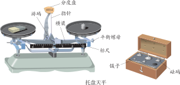
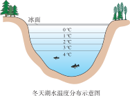

# 质量与密度

:::: grid 3

::: card title="质量"
质量是物体所含物质的多少，不随位置、形状、状态而改变。用**天平**测量。
:::

::: card title="密度"
同种物质的质量与体积的比值是一定的——这就是**密度**。$\rho = \cfrac{m}{V}$
:::

::: card title="测量密度"
用天平测质量，用量筒测体积，再利用密度公式计算。**排水法**是测量不规则固体体积的常用方法。
:::

::::

## 质量

### 质量的定义

::: info 质量
物体所含**物质的多少**叫作**质量**（mass），用符号 $m$ 表示。
:::

质量是物体的一个**基本属性**：物体的质量不随它的**位置**、**形状**和**物态**而改变。

> 例如：一块橡皮泥，无论捏成什么形状，无论被带到哪里，它所含的物质的量没有变，质量就不变。

### 质量的单位

| 单位 | 符号 | 换算关系 |
| :--- | :---: | :--- |
| 吨 | $\text{t}$ | $1\text{t}=10^3\text{kg}$ |
| 千克 | $\text{kg}$ | 国际单位制基本单位 |
| 克 | $\text{g}$ | $1\text{g}=10^{-3}\text{kg}$ |
| 毫克 | $\text{mg}$ | $1\text{mg}=10^{-3}\text{g}=10^{-6}\text{kg}$ |

### 常见物体的质量

| 物体 | 质量大约值 |
| :--- | :--- |
| 一枚大头针 | $80\text{mg}$ |
| 一元硬币 | $6\text{g}$ |
| 一个苹果 | $150\text{g}$ |
| 一瓶矿泉水 | $500\text{g}$ |
| 一名中学生 | $50\text{kg}$ |
| 一头大象 | $5\text{t}$ |

### 托盘天平的使用

实验室常用的测量质量的工具是**托盘天平**。

正确使用天平要做到「**放、调、测、读**」：

1. **放**：把天平放在**水平台**上，游码放在标尺左端的**零刻度线**处
2. **调**：调节横梁上的**平衡螺母**，使指针对准分度盘中央的刻度线，指针左偏向右调，右偏向左调
3. **测**：左物右码——把被测物体放在**左盘**，用镊子向右盘**由大到小**加减砝码，最后调节**游码**直到横梁恢复平衡
4. **读**：物体质量 = 砝码总质量 + 游码在标尺上所对的刻度值

::: tip 使用天平的注意事项
- 天平测量的是质量，不是重力
- 取放砝码要用**镊子**，不能直接用手
- 被测物体的质量**不能超过**天平的称量（量程）
- 潮湿的物体和化学药品**不能直接**放到天平的盘中
- 游码读数时读**左侧**所对的刻度值
:::

### 测量质量的特殊方法

**测量轻小物体的质量**（如一枚大头针）：测多算少法（累积法）——先测出 $n$ 枚大头针的总质量 $m_\text{总}$，则一枚的质量 $m = \cfrac{m_\text{总}}{n}$。

**测量液体质量**：差值法
1. 先测出空烧杯的质量 $m_\text{杯}$
2. 再测出烧杯和液体的总质量 $m_\text{总}$
3. 液体质量 $m_\text{液} = m_\text{总} - m_\text{杯}$

## 密度

### 探究：同种物质的质量与体积的关系

同一种物质，质量与体积的比值是**一定**的；不同物质，这个比值一般**不同**。

### 密度的定义

::: tip 密度的定义
🎯 某种物质组成的物体的**质量与它的体积之比**叫作这种物质的**密度**（density）。
:::

::: formula
$$
\rho = \frac{m}{V}
$$

- $\rho$：密度
- $m$：质量
- $V$：体积
:::

### 密度的单位

- 国际单位：千克每立方米，符号 $\text{kg/m}^3$
- 常用单位：克每立方厘米，符号 $\text{g/cm}^3$
- 换算关系：$1\text{g/cm}^3 = 10^3\text{kg/m}^3$

::: card title="单位换算技巧"
$$
1\text{g/cm}^3 = \frac{1\text{g}}{1\text{cm}^3} = \frac{10^{-3}\text{kg}}{10^{-6}\text{m}^3} = 10^3\text{kg/m}^3
$$
:::

### 密度是物质的特性

密度是物质的一种**特性**，同种物质的密度通常**相同**，不随物体的质量、体积、形状的改变而改变。

- 不同的物质，密度一般不同
- 同种物质在不同状态下密度可能不同（例如冰和水的密度不同）

### 常见物质的密度

| 物质 | 密度 $\rho/\text{kg}\cdot\text{m}^{-3}$ |
| :--- | :---: |
| 水 | $1.0\times 10^3$ |
| 冰 | $0.9\times 10^3$ |
| 酒精 | $0.8\times 10^3$ |
| 铁 | $7.9\times 10^3$ |
| 铜 | $8.9\times 10^3$ |
| 铝 | $2.7\times 10^3$ |

### 密度与温度

温度能够改变物质的密度。

物体受热或受冷时，它的体积一般都会发生变化。通常情况下，物体受热时会膨胀，遇冷时会收缩，物理学中把这种现象称为热胀冷缩。

在常见的物质中，气体的热胀冷缩最显著，它的密度受温度的影响也最大。一般固体、液体的热胀冷缩不像气体那样明显，因而它们的密度受温度的影响比较小。

**水的密度随温度变化的特点**

一般来说，同种物质温度越高密度越小，遵从热胀冷缩的规律，但是水比较特殊。水在 4 ℃时密度最大。温度高于 4 ℃时，
随着温度的升高，水的密度越来越小；温度低于 4 ℃时，随着温度的降低，水的密度也越来越小。水凝固成冰时体积变大，密度变小。 

水的密度是 $1.0\text{g/cm}^3$，结冰后密度变为 $0.9\text{g/cm}^3$。质量不变，体积膨胀——这就是冬天水管容易冻裂的原因。

## 密度的应用

### 利用密度求质量

对于不易直接称量质量的庞大物体（如大桥、石碑），可以通过密度公式的变形方便地求出质量：

::: formula
$$
m = \rho V
$$
:::

例如：大理石的密度约 $2.8\times 10^3\text{kg/m}^3$，一座石碑的体积约为 $10\text{m}^3$，则其质量 $m = \rho V = 2.8\times 10^3\text{kg/m}^3 \times 10\text{m}^3 = 2.8\times 10^4\text{kg} = 28\text{t}$。

### 利用密度求体积

对于形状不规则或不便于直接测量体积的物体，可以通过密度公式的变形方便地求出体积：

::: formula
$$
V = \frac{m}{\rho}
$$
:::

例如：用天平测得一块 $54\text{g}$ 的铝块，铝的密度 $\rho = 2.7\text{g/cm}^3$，则铝块的体积 $V = \cfrac{m}{\rho} = \cfrac{54\text{g}}{2.7\text{g/cm}^3} = 20\text{cm}^3$。

### 利用密度鉴别物质

通过测量密度，可以判断物体可能由什么物质组成——不同物质的密度一般不同。

#### 是否是纯种材料

通过测量实心“铅球”的密度是否和铅的密度一样来判断铅球的制造材料是否为纯铅。

::: info 细微差别中的重大发现
19 世纪末，英国物理学家瑞利在精确测量各种气体的密度时，发现从空气中取得的氮的密度是 $\text{1.257 2 kg/m}^3$，而从氨中取得的氮的密度却是 $\text{1.250 5 kg/m}^3$。虽经多次重复测量，但仍然存在这个令人奇怪的差异。

后来，他与化学家拉姆塞合作，于 1894 年在从空气中取得的氮里，分离出另一种当时还不知道的气体——氩，这个谜才解开了。原来，氩的密度较大，空气中的氮混有少量氩，它的密度就比从氨中取得的纯氮的密度稍大一点儿。

这是科学史上一个很有名的故事，它说明在科学实验中，精确的测量是多么重要。正是由于瑞利不放过这一细微差异而执着地研究下去，氩才得以被发现。瑞利因此荣获 1904 年的诺贝尔物理学奖。
:::

#### 空心与实心

对于金属球等物体，可以通过比较密度来判断是实心还是空心：

- 如果 $\rho_\text{物} = \rho_\text{材}$，则为实心
- 如果 $\rho_\text{物} < \rho_\text{材}$，则为空心

## 实验：测量物质的密度

### 量筒的使用

量筒是测量液体体积的工具。

::: tip 量筒的读数方法
读数时，视线要与**凹液面最低处相平**。
- 视线偏高（俯视）：读数偏大
- 视线偏低（仰视）：读数偏小
:::

### 实验原理

利用公式 $\rho = \cfrac{m}{V}$，分别测出物质的质量 $m$ 和体积 $V$。

### 测量固体的密度（排水法）

**实验器材**：天平、量筒、细线、被测固体（不吸水、不溶于水）

**实验步骤**：
1. 用天平测出固体的质量 $m$
2. 在量筒中倒入适量的水，读出体积 $V_1$
3. 用细线拴好固体，缓缓浸入量筒的水中，读出体积 $V_2$
4. 固体体积 $V = V_2 - V_1$
5. 代入公式计算密度

::: info 排水法
排开水的体积等于固体浸入部分的体积。**$V_\text{物} = V_2 - V_1$**
:::

::: tip 实验中的误差分析
- **先测质量再测体积**：大部分情况下推荐的操作顺序
- **先测体积再测质量**：如果先测体积，固体表面沾水会使质量偏大，导致密度偏大
:::

### 测量液体的密度

**实验器材**：天平、量筒、烧杯、被测液体

**实验步骤**（差值法）：
1. 用天平测出烧杯和液体的总质量 $m_1$
2. 将烧杯中的部分液体倒入量筒，读出体积 $V$
3. 用天平测出烧杯和剩余液体的总质量 $m_2$
4. 量筒中液体的质量 $m = m_1 - m_2$
5. 代入公式计算密度

::: tip 实验中的误差分析
- **测量液体密度时**：用差值法可以避免因液体倒不干净带来的误差
:::

## 实验探究

### 来自 PhET 的在线仿真实验

- [密度仿真实验](./phet-density) — 探究质量、体积与密度的关系
- [质量和弹簧仿真实验](./phet-masses-and-springs) — 通过弹簧伸长量感受质量与重力的关系

访问 [PhET 网站](https://phet.colorado.edu/zh_CN/) 查看所有在线仿真实验

## 速记

::: card

- **质量是属性**：不随位置、形状、状态改变。
- **天平使用**：放平、调零、左物右码、镊子取放。
- **密度公式**：$\rho = \cfrac{m}{V}$，单位换算 $1\text{g/cm}^3 = 10^3\text{kg/m}^3$。
- **密度是特性**：同种物质密度相同，不随 $m$、$V$ 改变。
- **排水法测体积**：$V_\text{物} = V_2 - V_1$。
- **液体密度差值法**：$m = m_1 - m_2$，避免残留误差。

:::
