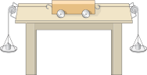

# 运动和力

前面我们学习了什么是力（力是物体对物体的作用），也认识了常见的力——弹力和重力。这一章我们开始研究**力和运动的关系**：物体为什么要运动、怎样才能保持运动、两个力同时作用在一个物体上会有什么效果。

这一章是学习压强、浮力等后面所有力学知识的逻辑基础。

:::: grid 4

::: card title="牛顿第一定律"
一切物体在不受力时总保持静止或匀速直线运动状态。这就是**惯性定律**。
:::

::: card title="二力平衡"
两个力作用在同一物体上，大小相等、方向相反、作用在同一直线上时，物体保持平衡状态。
:::

::: card title="摩擦力"
两个相互接触的物体，当它们发生相对运动（或有相对运动趋势）时，在接触面上产生一种阻碍相对运动的力。
:::

::: card title="力的合成"
同一直线上两个力可以合成为一个力。同向相加、反向相减。
:::

::::

## 牛顿第一定律 (Newton's First Law)

### 历史的争论

在认识"力与运动的关系"时，历史上曾有过长期的争论：

| 人物 | 观点 | 依据 |
| :--- | :--- | :--- |
| **亚里士多德** (古希腊) | 力是维持物体运动的原因 | 日常生活中，推车用力车才走，不用力车就停 |
| **伽利略** (意大利) | 力不是维持运动的原因，而是改变运动状态的原因 | 通过理想斜面实验推理得出 |

### 伽利略的理想斜面实验

伽利略通过以下推理，推翻了亚里士多德的观点：

::: info 理想斜面实验

1. 小球从左侧斜面某一高度滚下，会上升到右侧斜面**几乎相同的高度**
2. 如果减小右侧斜面的倾角，小球要滚到同样高度，就要滚**更长的距离**
3. 如果右侧斜面变成**水平面**，小球将**永远运动下去**（因为永远达不到原来的高度）

**结论**：如果水平面足够光滑，没有阻力，小球将一直做匀速直线运动。
:::

伽利略的这个实验是**理想实验**——它结合了实际观察和逻辑推理，在无法完全实现的条件下得出科学结论。

### 牛顿第一定律

::: tip 牛顿第一定律
🎯 一切物体总保持匀速直线运动状态或静止状态，除非作用在它上面的力迫使它改变这种状态。这就是著名的**牛顿第一定律**（Newton’s first law）
:::

对牛顿第一定律的理解：

- "没有受到力的作用"是一种理想情况，现实中物体受到多个力时，如果这些力**相互平衡**，效果等同于不受力
- 定律说明了**力和运动的关系**：力不是维持运动的原因，而是**改变物体运动状态**的原因
- 定律揭示了一切物体都有保持原来运动状态不变的性质——**惯性**

### 惯性

::: tip 惯性
一切物体都有保持原来运动状态不变的性质，这种性质叫做**惯性**（inertia）。

牛顿第一定律又被称为**惯性定律**（law of inertia）。
:::

惯性的理解：

- **一切物体**在任何情况下都具有惯性（无论静止还是运动）
- 惯性是物体**固有的属性**，**不是力**
- 惯性的大小只与物体的**质量**有关：质量越大，惯性越大，运动状态越难改变

::: tip 惯性与牛顿第一定律的关系
牛顿第一定律描述了物体不受力时的运动规律（**理想情况**），而惯性是物体本身的性质（**客观存在**）。正因为物体有惯性，所以不受力时会保持静止或匀速直线运动——**惯性是牛顿第一定律的物理基础**。
:::

#### 惯性的利用

- **跳远前助跑**——助跑后身体保持向前运动的状态，跳得更远
- **拍打衣服上的灰尘**——衣服运动，灰尘因惯性保持静止而脱离
- **锤头松了，把锤柄在地上撞几下**——锤柄突然停止，锤头因惯性继续向下运动而套紧
- **用盆泼水**——盆停止运动，水因惯性继续向前飞出

#### 防范惯性带来的危害

- **车辆行驶时系安全带**——急刹车时人因惯性继续向前，安全带把人拉住
- **保持车距**——前车急刹车时，后车因惯性需要一段距离才能停下
- **禁止超载**——质量越大惯性越大，刹车距离越长
- **公交车上的拉手**——车启动或刹车时，人因惯性前后倾倒，拉住扶手保持稳定

#### 对"惯性"常见的错误理解

- 不能说"受到惯性"或"惯性力"，惯性是物体的**固有属性**，不是力
- 不能说"惯性消失了"，一切物体任何时候都有惯性
- 不能说"速度越大惯性越大"，惯性大小只与**质量**有关

## 二力平衡 (Equilibrium of Two Forces)

### 平衡状态

物体受到几个力作用时， 如果保持**静止**或**匀速直线运动**状态，我们就说这几个力相互平衡，物体处于**平衡状态**。处于平衡状态的物体所受的⼒叫作**平衡⼒**。

### 二力平衡的条件

如果物体在两个力的作用下处于平衡状态，就叫做**二力平衡**。这两个力必须同时满足四个条件：

::: tip 二力平衡的条件
作用在**同一物体**上的两个力，如果**大小相等**、**方向相反**、并且在**同一直线**上，这两个力就彼此平衡。

> 简记为：**同体、等大、反向、共线**。
:::

**探究二力平衡的实验**

:::: grid sidebar-right card

::: grid-item

:::

::: grid-item
1. 使两个托盘里的钩码质量不相等；
2. 使两个托盘里的钩码质量相等；
3. 保持两个托盘里的钩码质量相等，把小车在水平桌面上扭转一个角度
:::
::::

### 二力平衡示例

| 应用场景 | 分析 |
| :--- | :--- |
| 悬挂的物体 | 拉力与重力平衡 |
| 水平面上匀速运动的物体 | 牵引力与阻力平衡 |
| 弹簧测力计测重力 | 弹簧拉力与重力平衡，示数等于重力 |

### 二力平衡与相互作用力的区别

初学者经常把"二力平衡"和"相互作用力"搞混，需要注意区分：

| 比较项 | 二力平衡 | 相互作用力 |
| :--- | :--- | :--- |
| 受力物体 | 作用在**同一个**物体上（A对B，C对B） | 作用在**两个不同**的物体上（A对B，B对A） |
| 力的性质 | 可以相同，也可以不同 | **一定相同** |
| 力的关系 | 大小相等、方向相反、共线 | 大小相等、方向相反、共线 |
| 同时性 | 不一定同时产生、同时消失 | 同时产生、同时消失 |
| 效果 | 使物体保持平衡 | 不能平衡（作用在不同物体上） |

::: tip 快速判断方法
- **看对象**：两个力作用在同一物体上 → 可能是平衡力；作用在两个物体上 → 一定是相互作用力
- **看效果**：物体静止或匀速直线运动 → 可能受平衡力
:::

## 摩擦力 (Friction)

### 摩擦力的定义

::: tip 摩擦力
两个相互接触的物体，当它们发生**相对运动**或具有**相对运动的趋势**时，在接触面上产生一种**阻碍相对运动**的力，这种力叫做**摩擦力**（friction force）。
:::

::: info 摩擦力的分类

| 类型 | 定义 | 示例 |
| :--- | :--- | :--- |
| **静摩擦力** | 物体有相对运动趋势但没有运动时受到的摩擦力 | 推桌子没推动，桌子受到的摩擦力 |
| **滑动摩擦力** | 物体在另一个物体表面上滑动时受到的摩擦力 | 用橡皮擦擦字，用钢笔写字 |
| **滚动摩擦力** | 物体在另一个物体表面上滚动时受到的摩擦力 | 滚动的足球、滚轮轴承 |

通常情况下，在相同压力下，**滚动摩擦力远小于滑动摩擦力**。
:::

### 摩擦力的方向

摩擦力的方向与物体**相对运动方向**（或**相对运动趋势方向**）**相反**。

::: tip 注意
- 摩擦力**不一定**与物体运动方向相反（例如：人走路时，脚向后蹬地，地面给脚的摩擦力是向前的）
- 判断摩擦力方向的关键是看"**相对**运动方向"，而不是"运动方向"
:::

### 影响滑动摩擦力大小的因素

::: tip 实验结论
滑动摩擦力的大小跟接触面**所受的压力**有关，接触面受到的压力越大，滑动摩擦力越大。滑动摩擦力的大小还跟接触面的**粗糙程度**有关，接触面越粗糙，滑动摩擦力越大。
:::

- 与压力大小有关：压力越大，摩擦力越大
- 与接触面粗糙程度有关：接触面越粗糙，摩擦力越大
- 与接触面积大小**无关**
- 与运动速度**无关**

### 摩擦的利用与防止

#### 增大摩擦的方法

- **增大压力**：如刹车时用力捏闸
- **增大接触面粗糙程度**：如鞋底的花纹、轮胎的花纹、瓶盖上的花纹
- **变滚动为滑动**：如急刹车时车轮不转，靠滑动摩擦减速

#### 减小摩擦的方法

- **减小接触面粗糙程度**：如把接触面打磨光滑
- **变滑动为滚动**：如轴承中的滚珠、滚轮
- **使接触面分离**：如加润滑油、磁悬浮列车

## 同一直线上二力的合成 (Composition of Forces on the Same Line)

### 合力

::: info 合力的概念
如果一个力单独作用的效果与几个力共同作用的效果相同，这个力就叫作那几个力的**合力**（resultant force）。
:::

- **合力**不是物体实际受到的力，而是为了研究方便"等效替代"的力
- 已知几个力的大小和方向，求合力的大小和方向，叫做**力的合成**(composition of forces)

### 同一直线上二力的合成

#### 情况一：方向相同

当两个力作用在同一物体上，方向相同时，合力的大小等于这两个力的大小之和，合力的方向与这两个力的方向相同。

::: formula
$$
F_{\text{合}} = F_1 + F_2
$$

方向：与 $F_1$、$F_2$ 方向相同
:::

**示例**：两个人同时推一辆车，一个人用 $100\text{N}$ 的力，另一个人用 $50\text{N}$ 的力，方向相同，则合力为 $150\text{N}$，方向与推力方向相同。

#### 情况二：方向相反

当两个力作用在同一物体上，方向相反时，合力的大小等于这两个力的大小之差，合力的方向与较大力的方向相同。

::: formula
$$
F_{\text{合}} = |F_1 - F_2|
$$

方向：与较大的力方向相同
:::

**示例**：一个物体受到水平向右 $100\text{N}$ 的拉力和水平向左 $30\text{N}$ 的阻力，则合力为 $70\text{N}$，方向水平向右。

### 力的合成与平衡

- 当两个力大小相等、方向相反、作用在同一直线上时（二力平衡），合力 $F_{\text{合}} = 0$
- 合力为零时，物体处于平衡状态（静止或匀速直线运动）

### 同一直线上二力合成的几种情况

| 条件 | 合力大小 | 合力方向 |
| :--- | :--- | :--- |
| $F_1$ 与 $F_2$ 方向相同 | $F_1 + F_2$ | 与 $F_1$、$F_2$ 方向相同 |
| $F_1$ 与 $F_2$ 方向相反，$F_1 > F_2$ | $F_1 - F_2$ | 与 $F_1$ 方向相同 |
| $F_1$ 与 $F_2$ 方向相反，$F_1 = F_2$ | $0$ | 无（二力平衡） |

## 实验探究

### 来自 PhET 的在线仿真实验

[力和运动](../force/phet-forces-and-motion)

访问 [PhET 网站](https://phet.colorado.edu/zh_CN/) 查看所有在线仿真实验

通过 PhET 仿真实验，你可以直观地观察力如何影响物体的运动，体验牛顿第一定律、二力平衡和摩擦力的概念。

## 速记

::: card

- **牛顿第一定律**：不受力时，静者恒静，动者恒做匀速直线运动
- **惯性**：物体保持原来运动状态的性质，大小只与质量有关
- **二力平衡**：同体、等大、反向、共线
- **平衡力与相互作用力**：看是否作用在同一物体上
- **摩擦力**：阻碍相对运动（或相对运动趋势）的力
- **摩擦力大小**：与压力大小和接触面粗糙程度有关
- **增大摩擦**：增大压力、增大粗糙程度
- **减小摩擦**：减小压力、加润滑油、变滑动为滚动
- **力的合成**：同向相加 $F_{\text{合}}=F_1+F_2$，反向相减 $F_{\text{合}}=|F_1-F_2|$
- **合力为零** → 物体处于平衡状态

:::
