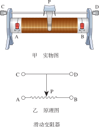
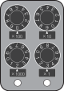
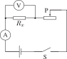

# 欧姆定律

欧姆定律是电学的核心规律，它揭示了电流、电压和电阻三者之间的定量关系。这一章从物质的导电性能说起，认识电阻的概念和影响电阻的因素，了解变阻器的工作原理，最终掌握欧姆定律及其在串并联电路中的应用。

:::: grid 3

::: card title="物质的导电性能"
有的物体容易导电，有的物体不容易导电。导体、绝缘体、半导体——它们在电路中扮演不同的角色。
:::

::: card title="电阻与变阻器"
电阻是导体对电流的阻碍作用。滑动变阻器和电阻箱可以改变电路中的电阻大小，是重要的电路元件。
:::

::: card title="欧姆定律"
$I = \frac{U}{R}$——导体中的电流跟导体两端的电压成正比，跟导体的电阻成反比。
:::

::::

## 物质的导电性能

### 导体和绝缘体

| 概念 | 定义 | 常见材料 |
| :--- | :--- | :--- |
| **导体** (conductor) | 容易导电的物体 | 金属、石墨（碳）、人体、大地、酸碱盐的水溶液 |
| **绝缘体** (insulator) | 不容易导电的物体 | 橡胶、塑料、玻璃、陶瓷、干燥的空气、油 |

::: tip 导电的本质
导体容易导电的原因是导体中有大量**自由电荷**（金属中的自由电子、溶液中的正负离子）。绝缘体中几乎没有自由电荷，所以不容易导电。
:::

导体和绝缘体之间**没有绝对的界限**。当条件改变时（如温度升高、加高电压），绝缘体也可能变成导体。

### 半导体

**半导体** (semiconductor) 的导电性能介于导体和绝缘体之间。

常见的半导体材料：**硅** (Si)、**锗** (Ge)

半导体的特性及应用：

| 特性 | 应用 |
| :--- | :--- |
| 光照影响导电性 | 光敏电阻、太阳能电池 |
| 温度影响导电性 | 热敏电阻 |
| 杂质影响导电性 | 二极管、三极管、集成电路（芯片） |

### 超导现象

某些金属或合金在温度降低到某一数值时，电阻会**突然消失**，这种现象叫做**超导现象**。处于超导状态的导体的电阻为 $0$。

超导体的应用前景：超导输电（无能量损耗）、超导磁悬浮列车、超导电机等。

## 电阻 (resistance)

### 电阻的概念

**电阻**表示导体对电流阻碍作用的大小，用字母 $R$ 表示。

在国际单位制中，电阻的单位是**欧姆** (ohm)，简称**欧**，符号 $\Omega$。

常用单位及换算：

| 单位 | 符号 | 换算 |
| :--- | :--- | :--- |
| 千欧 | $\text{k}\Omega$ | $1\ \text{k}\Omega = 10^3\ \Omega$ |
| 兆欧 | $\text{M}\Omega$ | $1\ \text{M}\Omega = 10^6\ \Omega$ |

> $1\ \Omega$ 的物理意义：当导体两端电压为 $1\ \text{V}$，通过导体的电流为 $1\ \text{A}$ 时，这段导体的电阻就是 $1\ \Omega$。

### 影响电阻大小的因素

电阻是导体本身的一种性质，它的大小由导体的**材料**、**长度**、**横截面积**和**温度**决定，与电压、电流无关。

| 因素 | 对电阻的影响 |
| :--- | :--- |
| **材料** | 不同材料的导电性能不同（银 > 铜 > 铝 > 铁） |
| **长度** | 在材料和横截面积相同时，导体**越长**，电阻**越大** |
| **横截面积** | 在材料和长度相同时，横截面积**越大**，电阻**越小** |
| **温度** | 对大多数金属导体，温度**升高**，电阻**增大**（灯丝电阻受温度影响明显） |

::: info 导体电阻的计算

公式：$R = \rho\dfrac{L}{S}$

- $R$：电阻 $(\Omega)$
- $\rho$：电阻率 $(\Omega \cdot \text{m})$，由材料决定
- $L$：导体的长度 $(\text{m})$
- $S$：导体的横截面积 $(\text{m}^2)$
:::

## 变阻器

变阻器是通过改变接入电路中电阻线的**长度**来改变电阻大小的装置。

### 滑动变阻器

**结构**：瓷筒、涂有绝缘层的电阻线绕成的线圈、金属棒、滑片、四个接线柱。

**原理**：通过改变接入电路中电阻线的**长度**来改变电阻。

**作用**：
1. 保护电路
2. 通过改变自身电阻，调节电路中的电流和电压

**接法**：

| 接法 | 说明 |
| :--- | :--- |
| **正确接法** | **一上一下**（接上柱一个、下柱一个） |
| **错误接法** | 都接上柱 → 接入电阻为 $0$（短路）；都接下柱 → 相当于定值电阻（不能变阻） |

::: tip 滑动变阻器使用注意事项
1. 闭合开关前，滑片应滑到**阻值最大**的位置（保护电路）
2. 不能超过滑动变阻器铭牌上标注的**最大电流**
3. 应**串联**在需要调节电流的电路中
:::

### 电阻箱

**电阻箱**是一种能够显示接入电路电阻大小的变阻器。

**读数方法**：各旋盘对应的指示点（三角形）的示数乘以面板上标记的倍数，然后加在一起，就是接入电路的阻值。

**与滑动变阻器的比较**：

| 比较项 | 滑动变阻器 | 电阻箱 |
| :--- | :--- | :--- |
| 变阻方式 | 连续改变电阻 | 跳跃式改变电阻 |
| 能否读数 | 不能直接读出阻值 | 能直接读出阻值 |
| 精度 | 可连续调节，精度高 | 阻值准确，有最小分度 |

## 欧姆定律

### 探究：电流与电压和电阻的关系

**实验一：保持电阻不变，探究电流与电压的关系**

控制 $R$ 不变，改变 $U$，观察 $I$ 的变化。

结论：当电阻一定时，通过导体的电流跟导体两端的电压成**正比**。

**实验二：保持电压不变，探究电流与电阻的关系**

控制 $U$ 不变，改变 $R$，观察 $I$ 的变化。

结论：当电压一定时，通过导体的电流跟导体的电阻成**反比**。

### 欧姆定律的内容

::: tip 欧姆定律 (Ohm's law)
🎯 导体中的电流，跟导体两端的电压成正比，跟导体的电阻成反比。
:::

::: formula
$$
I = \frac{U}{R}
$$

- $I$ — 电流 (A)
- $U$ — 电压 (V)
- $R$ — 电阻 ($\Omega$)
:::

::: warning 欧姆定律的注意事项
1. **同体性**：$I$、$U$、$R$ 必须对应**同一个导体**或**同一段电路**
2. **同时性**：$I$、$U$、$R$ 必须是同一时刻的值
3. **因果关系**：电压 $U$ 是原因，电流 $I$ 是结果，不能说"电阻跟电压成正比"
4. **适用范围**：欧姆定律适用于金属导体和电解质溶液，不适用于含源电路和非线性元件
:::

### 欧姆定律的变形公式

| 公式 | 用途 | 说明 |
| :--- | :--- | :--- |
| $I = \cfrac{U}{R}$ | 求电流 | 欧姆定律的原始形式 |
| $U = IR$ | 求电压 | 已知电流和电阻计算电压 |
| $R = \cfrac{U}{I}$ | 求电阻 | 伏安法测电阻的原理 |

::: tip 理解 $R = \frac{U}{I}$
$R = \cfrac{U}{I}$ 是电阻的计算式，而不是决定式。电阻 $R$ 由材料、长度、横截面积和温度决定，与 $U$ 和 $I$ 无关。

举例：即使导体两端没有电压（$U = 0$），电流为零，电阻仍然存在。
:::

## 欧姆定律的应用

### 伏安法测电阻

**原理**：利用欧姆定律计算电阻

::: formula
$$
R = \frac{U}{I}
$$
:::

**电路设计**：
- 用**电流表**测通过未知电阻 $R_x$ 的电流 $I$
- 用**电压表**测 $R_x$ 两端的电压 $U$
- 用**滑动变阻器**改变电路中的电流和电压，进行多次测量求平均值

**实验步骤**：
1. 按电路图连接实物，开关断开，滑片置于阻值最大处
2. 闭合开关，调节滑动变阻器，分别读取电流表和电压表的示数
3. 计算 $R_x = \cfrac{U}{I}$，多次测量求平均值以减小误差

### 串联电路的电阻特点

串联电路的总电阻（等效电阻）等于各串联电阻之和：

::: formula
$$
R = R_1 + R_2 + \cdots + R_n
$$
:::

若 $n$ 个相同的电阻 $R_0$ 串联，则 $R = nR_0$。

**推导依据**：串联电路中 $I = I_1 = I_2$，$U = U_1 + U_2$
由 $U = IR$，$U_1 = I_1R_1$，$U_2 = I_2R_2$，代入得 $IR = IR_1 + IR_2$，即 $R = R_1 + R_2$。

**理解**：电阻串联后相当于增加了导体的**长度**，所以总电阻比任何一个分电阻都大。

### 串联电路的分压特点

串联电路中各个电阻两端的电压与它们的电阻成正比：

::: formula
$$
U_1:U_2: \cdots :U_n=R_1:R_2: \cdots :R_n
$$
:::

**推导依据**：串联电路中 $I = I_1 = I_2$，由 $U_1 = I_1R_1$，$U_2 = I_2R_2$ 得 $\frac{U_1}{U_2}=\frac{IR_1}{IR_2}$，即 $\frac{U_1}{U_2}=\frac{R_1}{R_2}$。

### 并联电路的电阻特点

并联电路的总电阻（等效电阻）的倒数等于各并联电阻倒数之和：

::: formula
$$
\frac{1}{R} = \frac{1}{R_1} + \frac{1}{R_2} + \cdots + \frac{1}{R_n}
$$
:::

两个电阻并联时：$R = \dfrac{R_1R_2}{R_1 + R_2}$

若 $n$ 个相同的电阻 $R_0$ 并联，则 $R = \dfrac{R_0}{n}$。

**推导依据**：并联电路中 $I = I_1 + I_2$，$U = U_1 = U_2$
由 $I = \frac{U}{R}$，$I_1 = \frac{U_1}{R_1}$，$I_2 = \frac{U_2}{R_2}$，代入得 $\frac{U}{R} = \frac{U}{R_1} + \frac{U}{R_2}$，即 $\frac{1}{R} = \frac{1}{R_1} + \frac{1}{R_2}$。

**理解**：电阻并联后相当于增加了导体的**横截面积**，所以总电阻比任何一个分电阻都小。

### 并联电路的分流特点

并联电路中各个支路的电流与各支路电阻成反比：

::: formula
$$
I_1:I_2: \cdots :I_n = \frac{1}{R_1} : \frac{1}{R_2} : \cdots : \frac{1}{R_n}
$$
:::

两个电阻并联时：$\dfrac{I_1}{I_2} = \dfrac{R_2}{R_1}$

**推导依据**：并联电路中 $U = U_1 = U_2$
由 $I_1 = \frac{U_1}{R_1}$，$I_2 = \frac{U_2}{R_2}$ 得 $\frac{I_1}{I_2} = \frac{\frac{U}{R_1} }{\frac{U}{R_2}}$，即 $\frac{I_1}{I_2} = \frac{\frac{1}{R_1} }{\frac{1}{R_2}}$ 或 $\frac{I_1}{I_2} = \frac{R_2}{R_1}$。

### 串并联电路对比总结

| 比较项 | 串联电路 | 并联电路 |
| :--- | :--- | :--- |
| 电流 | $I = I_1 = I_2$ | $I = I_1 + I_2$ |
| 电压 | $U = U_1 + U_2$ | $U = U_1 = U_2$ |
| 电阻 | $R = R_1 + R_2$ | $\dfrac{1}{R} = \dfrac{1}{R_1} + \dfrac{1}{R_2}$ |
| 分压/分流 | $\dfrac{U_1}{U_2} = \dfrac{R_1}{R_2}$（正比分压） | $\dfrac{I_1}{I_2} = \dfrac{R_2}{R_1}$（反比分流） |

## 实验探究

### 来自 PhET 的在线仿真实验

- [电线的电阻](./phet-resistance-in-a-wire) — 探究导体材料、长度、横截面积对电阻的影响
- [部分电路欧姆定律](./phet-ohms-law) — 探究电流与电压、电阻的定量关系，验证 $I = \cfrac{U}{R}$
- [电路组件实验：直流](../simple-circuits/phet-circuit-kit.md) — 搭建电路，用伏安法测电阻，研究串并联电路的电阻规律

访问 [PhET 网站](https://phet.colorado.edu/zh_CN/) 查看所有在线仿真实验

## 速记

::: card

- **导体与绝缘体**：导体有自由电荷，绝缘体几乎没有自由电荷
- **电阻**：$R = \cfrac{\rho L}{S}$，与材料、长度、横截面积、温度有关，与 $U$、$I$ 无关
- **滑动变阻器**：一上一下接法，闭合开关前滑片置于阻值最大处
- **欧姆定律**：$I = \dfrac{U}{R}$（同体、同时）
- **串联电阻**：$R = R_1 + R_2$，越串越大
- **并联电阻**：$\dfrac{1}{R} = \dfrac{1}{R_1} + \dfrac{1}{R_2}$，越并越小

:::
