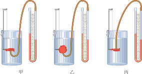
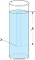
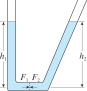
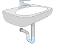
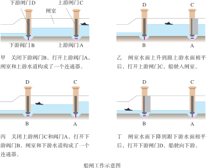
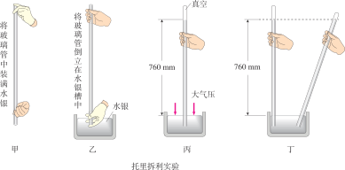
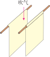
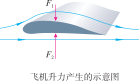

# 压强

## 压力

::: info 压力定义
垂直作用在物体表面上的力叫做**压力**。
:::

### 压力的特点

- 压力的方向：垂直于接触面，指向被压物体
- 压力的作用点：在接触面上
- 压力的大小：取决于挤压程度

#### 压力与其反作用力的演示

<Newton3rdLaw />

### 压力与重力的区别

#### 压力与重力的关系

- 因物体有重力会挤压其下面的物体，由此产生压力
- 只有当物体不受其他外力的情况下，静止在水平面上时，压力才等于重力（物体对水平面的压力与它受到的重力的大小和方向相同）

#### 水平面上物体的重力与产生的压力的演示

<GravityVsPressure1 />

#### 压力与重力的对比

|      |        压力        |      重力      |
| :--- | :----------------: | :------------: |
| 定义 | 垂直作用在物体表面的力 | 地球对物体的吸引力 |
| 施力物体 | 接触的、产生挤压的物体 |      地球      |
| 方向 | 垂直于接触面指向被压物体 |     竖直向下     |
| 作用点 |       接触面上       |     重心       |

#### 初学者容易把压力和重力混淆的原因

看看自己有没有因为下面的原因而混淆压力与重力：

- 对“力”的理解往往还停留在“沉不沉”的直觉上
- 对于物体静止在水平面上这种常见的场景，压力和重力的大小和方向都相同，容易产生它们是同一个力的错觉

根据下面的事实来破除这种错觉：

-  压力**不一定**是由重力产生的（比如手按墙）。
-  即使压力是由重力引起的，它也**不一定**与重力大小相等、方向相同（比如斜面）。

打破重力即压力错觉的小实验：

- 实验一
  - **操作**：用手指水平顶住一块橡皮擦，使其静止在竖直的课本上。
  - **问题**：此时橡皮对课本的压力方向是朝向哪里？重力呢？
- 实验二
  - **操作**：将一本书平放在手上，感受压力；然后另一只手用力向下按这本书。
  - **问题**：书的重力变了吗？你手感受到的压力变了吗？

#### 区分压力与重力的小窍门

- 看“方向”：压力的方向**永远**「`垂直于接触面`」，重力的方向**永远**「`竖直向下`」
- 看“源头”：是接触的、产生挤压的物体（压力），还是地球（重力）

#### 压力与重力的关系与区别的演示

下面的演示图片中，绿色箭头表示方块所受的重力，红色箭头表示方块对 L 型容器两个面的压力。通过旋转 L 型容器，我们可以观察这两种力随旋转角度的变化，从而可以更好地理解下面几个问题：

- 压力与重力方向的区别
- 压力与重力大小的区别
- 压力与重力作用点的区别
- 物体间存在只接触而没有压力的情况

<GravityVsPressure2 />

## 压强 (pressure)

::: tip 压强定义
🎯 物体所受压力的大小与受力面积之比叫作**压强**。
:::

**公式**
::: formula
$$
p = \cfrac{F}{S}
$$

- $p$：压强
- $F$：压力
- $S$：受力面积
:::

### 物理意义

压强是表示压力作用效果的物理量。压强越大，压力的作用效果越明显。

### 压强的单位

- 国际单位：帕斯卡 (pascal)，简称帕，符号 $\text{Pa}$
- $1\text{Pa} = 1\text{N/m}^2$
- 常用单位还有：$\text{kPa}$（千帕）、$\text{MPa}$（兆帕）

### 增大和减小压强的方法

#### 增大压强的方法 ($\text{F}$ ⤴️ $\text{S}$ ⤵️)

1. **增大压力**：在受力面积不变时，增大压力可以增大压强
2. **减小受力面积**：在压力不变时，减小受力面积可以增大压强

**应用实例**：
- 针尖做得很尖——减小受力面积
- 图钉的钉尖很尖——减小受力面积
- 菜刀的刀刃磨得很薄——减小受力面积

#### 减小压强的方法 ($\text{F}$ ⤵️ $\text{S}$ ⤴️)

1. **减小压力**：在受力面积不变时，减小压力可以减小压强
2. **增大受力面积**：在压力不变时，增大受力面积可以减小压强

**应用实例**：
- 骆驼的脚掌很大——增大受力面积
- 坦克的履带很宽——增大受力面积
- 书包的背带做得较宽——增大受力面积
- 铁轨下面铺枕木——增大受力面积

## 液体压强

### 液体压强的特点

1. 液体对容器底和容器壁都有压强
2. 液体内部向各个方向都有压强
3. 在同一深度，液体向各个方向的压强相等
4. 液体压强随深度的增加而增大
5. 液体的压强还与液体的密度有关，在深度相同时，液体密度越大，压强越大

::: info **微小压强计**

- **结构**：探头，橡胶膜，U 型玻璃管
- **使用方法**
  1. 按压探头上的橡胶膜，观察 U 型管两侧液面高度差是否发生变化，以检查是否漏气
  2. 将探头放入液体中，U 型管两侧液面高度差表示压强大小
:::

### 液体压强的大小

**公式**
::: formula
$$
p = \rho g h
$$

- $p$：液体压强
- $\rho$：液体密度
- $g$：重力加速度
- $h$：液体深度（从液面到该点的竖直距离）
:::

**液体压强公式推导**

要想得到液面下某处的压强，可以设想这里有一个水平放置的“平面”。这个平面上方的液体组成了一个竖直液柱，该液柱对平面的压力等于液柱所受的重力。  

在上图中，设液柱的高度为 $h$、平面的面积为 $S$，则这个平面上方的液柱对平面的压力
::: formula
$$
F=G=mg=\rho Vg=\rho Shg
$$
:::
平面受到的压强
::: formula
$$
p=\cfrac{F}{S}=\rho gh
$$
:::

:::: grid sidebar-right card
::: grid-item

**帕斯卡裂桶实验**

**实验的意义**

- 在此之前，人们往往直觉地认为压强的大小取决于液体的重量。帕斯卡通过实验证明：液体的压强只与液体的深度（高度）有关，而与液体的质量、总体积或容器的形状无关。即使细管中水的总重量很轻，但由于高度 $h$ 非常大，产生的压强足以破坏木桶。
- 实验直观地体现了液体的压力传递特性。

**帕斯卡定律**
> 密闭液体上的压强能够大小不变地由液体向各个方向传递。
:::

::: grid-item

:::
::::

### 连通器

::: info 连通器定义
上端开口、下端连通的容器叫作**连通器**。
:::

**证明**： 如果连通器内装有相同的液体，液体不流动时，连通器各部分容器中液面的高度总是相同的。

> 想象在连通器底部液体中有一个竖直方向的很薄的液片，我们把它作为研究对象。液片两侧受到的压力分别是 $F_1$ 和 $F_2$，液片静止时，由二力
平衡可知 $F_1=F_2$。设液体密度为 $ρ$、液片面积为 $S$、连通器两侧液面的高度分别为 $h_1$ 和 $h_2$，则 $ρgh_1S=ρgh_2S$，由此可得 $h_1=h_2$。这表明当液体不流动时，连通器各部分容器中液面的高度总是相同的。

#### 连通器的应用

- 烧水壶
- 洗手池 U 型存水弯
- 锅炉水位计
- 透明软管找平 [【连通器原理《银河补习班》-认识连通器原理应用的最好的视频】](https://www.bilibili.com/video/BV1yF411T7NL/?share_source=copy_web&vd_source=407aff227f9af6245191f8fbf47f5385)
- 船闸

:::: grid 2
::: grid-item

:::

::: grid-item

:::
::::

**船闸工作原理**

::: card

:::

## 大气压强

::: info 大气压强定义
大气对浸在它里面的物体产生的压强叫做**大气压强**，简称**大气压**。
:::

:::info 大气压与海拔的关系
海平面处于大气的底部，大气压较大，越往高处，能够压迫它的大气就越少，所以大气压强的值就越小。
:::

:::info 水的沸点与大气压的关系
水的沸点在标准大气压下是 100 °C，随着大气压的 减小，水的沸点也会降低。
:::

### 大气压的测量

- **托里拆利实验**：测出标准大气压约为 $1.013 \times 10^5\text{Pa}$
- **标准大气压**：等于 $760\text{mm}$ 高水银柱产生的压强

### 大气压的应用

- 吸盘挂钩
- 胶头滴管
- 活塞式抽水机
- 离心式水泵
- 吸管喝水

## 流体压强与流速的关系

::: tip 流体压强与流速的关系
在气体和液体中，流速越大的位置，压强越小。
:::

向下吹气时，两张纸向中间靠拢

### 飞机的升力

### 生活中的应用
- 固定翼飞机
- 赛车的气流偏导器
- 水翼船
- 喷雾器

### 对生活的影响
- 窗帘因沿着墙面吹过的风飘向窗外
- 在高铁站人越过安全线，即使与车辆保持一定的距离，也是非常危险的
- 大风天气会把不结实的房顶吹走，虽然风没有从屋里向上吹房顶
- 大风天气还会造成安装不牢固的玻璃窗向外脱落
- 同向高速行驶的船只靠近时容易相撞

## 常见压强数值

| 情景 | 压强大约值 |
| :--- | :--- |
| 一张报纸平放对桌面的压强 | $0.5\text{Pa}$ |
| 人站立时对地面的压强 | $1.5 \times 10^4\text{Pa}$ |
| 标准大气压 | $1.01 \times 10^5\text{Pa}$ |
| 坦克对地面的压强 | $3 \sim 4 \times 10^4\text{Pa}$ |
