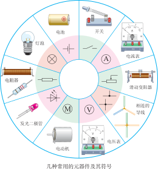
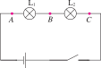
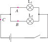
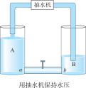
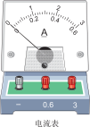
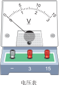

# 简单电路

电学是初中物理的重要组成部分。这一章从最基础的静电现象开始，逐步认识电路的基本组成、两种基本的连接方式——串联和并联，以及电流和电压这两个核心物理量。掌握电流表、电压表的使用方法，并归纳串、并联电路中电流和电压的规律。

:::: grid 3

::: card title="静电现象"
摩擦起电、两种电荷、原子结构——电学的起点，认识电荷从何而来。
:::

::: card title="电路与连接方式"
电路由电源、导线、开关、用电器组成。串联和并联是两种最基本的连接方式。
:::

::: card title="电流、电压与测量"
电流表测电流，电压表测电压。串并联电路中电流和电压各有其规律。
:::

::::

## 简单静电现象

### 摩擦起电

用丝绸摩擦玻璃棒，玻璃棒能吸引轻小物体；用毛皮摩擦橡胶棒，橡胶棒也能吸引轻小物体。物体经过摩擦后能够**吸引轻小物体**，我们就说它带了"电"，或者说带了**电荷** (electric charge)。这种用摩擦的方法使物体带电的现象叫做**摩擦起电**。

### 两种电荷

自然界中只有**两种电荷**：

| 电荷种类 | 规定 | 实例 |
| :--- | :--- | :--- |
| **正电荷** (positive charge) | 用丝绸摩擦过的玻璃棒所带的电荷 | 玻璃棒带正电 |
| **负电荷** (negative charge) | 用毛皮摩擦过的橡胶棒所带的电荷 | 橡胶棒带负电 |

**电荷间的相互作用规律**：

- **同种电荷相互排斥**
- **异种电荷相互吸引**

物体所带电荷有多有少，电荷的多少叫作**电荷量**，符号为 $Q$。电荷量的单位是**库仑** (coulomb)，简称**库**，符号是 $C$。

### 摩擦起电的原因

::: tip 摩擦起电
🎯 摩擦起电的实质是**电子的转移**：两个物体相互摩擦时，一个物体失去电子而带正电，另一个物体获得电子而带负电。
:::

::: grid sidebar-left

原子由原子核和核外电子构成。原子核带正电，电子带负电。正常情况下，原子核所带正电荷数与电子所带负电荷数相等，原子呈电中性。摩擦起电就是通过摩擦使物体获得或失去电子，从而带上电荷。
:::

::: info 通过传导的方式使物体带电
除了摩擦起电，还有其他方式使物体带电。

当带电的物体接触另⼀个不带电的物体时，电荷可以在这两个物体之间转移，这是⽤传导的⽅式使物体带电。

**静电感应与放电**

一个带电体靠近（不接触）导体时，会使导体靠近带电体的一端带异种电荷，远离的一端带同种电荷，这种现象叫做**静电感应**。

当物体所带电荷积累到一定程度时，会发生**静电放电**现象——正负电荷迅速中和，产生火花或电击。
:::

### 验电器

**验电器**是用来检验物体是否带电的仪器。

验电器的工作原理：当带电体接触验电器的金属球时，两片金属箔片带上**同种电荷**，相互**排斥**而张开。所带电荷越多，箔片张开的角度越大。

### 静电的防止和利用

**静电的危害**：

- 在印刷厂中，纸张之间的静电吸附会导致走纸不顺
- 在加油站，静电放电可能引燃易燃蒸汽
- 电子元件可能被静电放电击穿损坏

**防止静电的方法**：

- **接地**：将静电导入大地，例如：油罐车尾部拖一条铁链，及时导走静电
- **增加空气湿度**：潮湿的空气更容易导走电荷
- **使用抗静电材料**：如添加抗静电剂

**静电的利用**：

- **静电复印**：利用静电吸引墨粉
- **静电除尘**：利用静电吸附空气中的粉尘
- **静电喷涂**：使涂料带电后均匀附着在工件表面

## 电路基础

### 电路的组成

一个最基本的电路 (electric circuit) 由四个部分组成：

| 元件 | 作用 |
| :--- | :--- |
| **电源** (power supply) | 提供电能（如电池 (cell)、发电机） |
| **导线** | 连接电路，输送电能 |
| **开关** | 控制电路的通断 |
| **用电器** | 消耗电能，将电能转化为其他形式的能（如灯泡、电机） |

### 常用电路元器件和符号

### 电路图

用规定的符号表示电路连接的图叫做**电路图**。画电路图时应注意：

1. 元件符号要用统一规定的符号
2. 连接线要画成横平竖直的直线
3. 不要把电路元件画在拐角处
4. 尽量⽤最简洁的形式呈现出电路的连接情况

### 三种电路状态

- **通路**：又叫闭合电路，电路处处连通，有电流通过。
- **断路**：又叫开路，电路在某处断开，没有电流通过。
- **短路**：导线直接连接在电源两端（或用电器的两端），电流不经用电器，可能损坏电源。

### 连接电路的注意事项

1. 连接电路前，要先断开开关。
2. 连接完毕后，要先检查电路连接是否正确。
3. 接通电源时，要先进⾏试触（开关闭合瞬间再断开），确认没有异常后再将开关闭合。
4. 实验完毕后，要先断开开关，再拆除电路，并整理好实验器材。

## 串联电路和并联电路

### 串联电路

把电路元件**逐个按顺序首尾连接**起来的方式叫做**串联** (series connection)。

串联电路的特点：

- 电流只有**一条路径**
- 各用电器**相互影响**：一个断开，所有用电器都不工作
- 开关控制**整个电路**，与位置无关

### 并联电路

把电路元件**并列连接**在电路中的方式叫做**并联** (parallel connection)。

并联电路中多个用电器共用的那部分电路叫**干路**，单独使用的那部分电路叫**支路**。

并联电路的特点：

- 电流有**多条路径**（多条支路）
- 各用电器**独立工作**：一条支路断开，其他支路不受影响
- 干路开关控制整个电路，支路开关只控制所在支路

### 识别方法

**节点法**：在电路中找"分岔点"——如果从电源正极出发只有一条路可走，则是串联；如果有分岔（节点），则是并联。

## 电流、电压及其测量

### 电流

电荷的**定向移动**形成电流 (electric current)。

- 符号：$I$
- 国际单位：安培 (ampere)，简称安，符号 $\text{A}$
- 常用单位：$\text{mA}$（毫安）、$\mu\text{A}$（微安）
- 换算关系：$1\ \text{A} = 1000\ \text{mA}$，$1\ \text{mA} = 1000\ \mu\text{A}$

**人们把正电荷定向移动的方向规定为电流的方向**。

我们用每秒内通过导体横截⾯的电荷量来表示电流的强弱：

::: formula
$$
I = \frac{Q}{t}
$$
:::

### 电压

**电压** (voltage) 是使电路中形成电流的原因，电源是提供电压的装置。

- 符号：$U$
- 国际单位：伏特 (volt)，简称伏，符号 $\text{V}$
- 常用单位：$\text{kV}$（千伏）、$\text{mV}$（毫伏）
- 换算关系：$1\ \text{kV} = 1000\ \text{V}$，$1\ \text{V} = 1000\ \text{mV}$

**电压的比喻——抽水机**

水流能推动水轮机转动，是因为水有**水压**；电荷能在电路中定向移动，是因为电路两端有**电压**。

> **电源**保持电压使电荷不断定向移动形成电流，就像抽水机保持水压使水不断流动。

### 电流表及其使用

**电流表**用于测量电路中的电流。

| 使用规则 | 说明 |
| :--- | :--- |
| **串联** | 电流表必须**串联**在待测电路中 |
| **正进负出** | 电流从**正接线柱**流入，从**负接线柱**流出 |
| **量程选择** | 不能超过量程，先用大量程试触 |
| **不允许直接接电源** | 绝对不允许将电流表直接接在电源两极上 |

### 电压表及其使用

**电压表**用于测量电路两端的电压。

| 使用规则 | 说明 |
| :--- | :--- |
| **并联** | 电压表必须**并联**在待测电路两端 |
| **正进负出** | 电流从**正接线柱**流入，从**负接线柱**流出 |
| **量程选择** | 不能超过量程，先用大量程试触 |
| **可以直接接电源** | 电压表可以直接接在电源两极上（测电源电压） |

## 串、并联电路中电流的特点

### 串联电路中电流的特点

::: formula
$$
I = I_1 = I_2 = \cdots = I_n
$$
:::

**串联电路中，电流处处相等**。无论用电器规格是否相同，通过各处的电流大小都相等。

例如下面的电路中 A, B, C 三点的电流关系为：$I_A = I_B = I_C$

### 并联电路中电流的特点

::: formula
$$
I = I_1 + I_2 + \cdots + I_n
$$
:::

例如下面的电路中 A, B, C 三点的电流关系为：$I_C = I_A + I_B$

**并联电路中，干路电流等于各支路电流之和**。支路越多，干路电流越大。

## 串、并联电路中电压的特点

### 串联电路中电压的特点

::: formula
$$
U = U_1 + U_2 + \cdots + U_n
$$
:::

**串联电路中，总电压等于各部分电路两端电压之和**。

例如下面的电路中 A, B, C 三点的电压关系为：$U_{AC} = U_{AB} = U_{BC}$

### 并联电路中电压的特点

::: formula
$$
U = U_1 = U_2 = \cdots = U_n
$$
:::

**并联电路中，各支路两端的电压相等**。

## 串并联对比总结

| 对比项 | 串联 | 并联 |
| :--- | :--- | :--- |
| 路径 | 一条 | 多条 |
| 电流 | $I = I_1 = I_2$（处处相等） | $I = I_1 + I_2$（干路等于各支路之和） |
| 电压 | $U = U_1 + U_2$（总电压等于各部分之和） | $U = U_1 = U_2$（各支路电压相等） |
| 相互影响 | 各用电器相互影响 | 各用电器独立工作 |
| 开关控制 | 控制整个电路 | 干路控制全部，支路控制所在支路 |

## 实验探究

### 来自 PhET 的在线仿真实验

- [气球和静电（摩擦起电）](./phet-balloons-static) — 探究摩擦起电现象，观察电荷的相互作用
- [静电电压](./phet-john-travoltage) — 探究静电的感应与放电现象
- [电路组件实验：直流](./phet-circuit-kit) — 搭建串联和并联电路，用电流表和电压表测量电流和电压

访问 [PhET 网站](https://phet.colorado.edu/zh_CN/) 查看所有在线仿真实验

## 速记

::: card

- **两种电荷**：正电荷（丝绸摩擦玻璃棒）和负电荷（毛皮摩擦橡胶棒），同性相斥、异性相吸。
- **电路组成**：电源、导线、开关、用电器。
- **串联**：电流 $I = I_1 = I_2$，电压 $U = U_1 + U_2$，各用电器相互影响。
- **并联**：电流 $I = I_1 + I_2$，电压 $U = U_1 = U_2$，各用电器独立工作。
- **电流表**：串联、正进负出、不能直接接电源。
- **电压表**：并联、正进负出、可以直接接电源测电源电压。

:::
