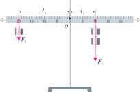
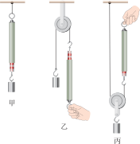
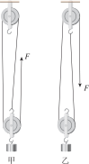
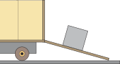

# 简单机械

简单机械是初中力学知识的综合应用，核心是研究如何用更小的力或更方便的方式完成工作。这一章围绕**杠杆**、**滑轮**、**滑轮组**展开，再简要了解**轮轴**和**斜面**，最后学习机械效率的概念。

:::: grid 3
::: card title="杠杆"
一根硬棒在力的作用下能绕固定点转动，就构成了杠杆。杠杆的平衡条件是：$F_1L_1 = F_2L_2$。
:::

::: card title="滑轮"
周边有槽、可绕轴转动的轮子。定滑轮不省力但改变力的方向；动滑轮省一半力。滑轮组既能省力又能改变力的方向。
:::

::: card title="机械效率"
有用功跟总功的比值叫做机械效率。任何机械都不可避免地要做额外功，因此机械效率总是小于 $100\%$。
:::

::::

## 杠杆 (lever)

### 杠杆的定义

::: info 杠杆
一根硬棒，在力的作用下能绕着**固定点**转动，这根硬棒就是**杠杆**。
:::

杠杆的五要素：

| 要素 | 符号 | 说明 |
| :--- | :--- | :--- |
| **支点** | $O$ | 杠杆可以绕其转动的固定点 |
| **动力** | $F_1$ | 使杠杆转动的力 |
| **阻力** | $F_2$ | 阻碍杠杆转动的力 |
| **动力臂** | $L_1$ | 支点到动力作用线的距离 |
| **阻力臂** | $L_2$ | 支点到阻力作用线的距离 |

::: tip 力臂的画法
力臂是**支点到力的作用线的垂直距离**，不是支点到力的作用点的距离。画力臂时，从支点向力的作用线作垂线。
:::

### 杠杆的平衡条件

当杠杆在动力和阻力的作用下静止时，我们就说杠杆平衡了。

::: formula
$$
F_1L_1 = F_2L_2
$$

- $F_1$：动力
- $L_1$：动力臂
- $F_2$：阻力
- $L_2$：阻力臂
:::

::: tip 杠杆平衡条件的理解
$\frac{F_1}{F_2} = \frac{L_2}{L_1}$，即动力臂是阻力臂的几倍，动力就是阻力的几分之一。
:::

**探究杠杆的平衡条件**
::: card

杠杆平衡条件实验：通过调节钩码数量和位置，使杠杆在水平位置平衡，记录动力、动力臂、阻力、阻力臂，归纳出 $F_1L_1 = F_2L_2$。
:::

### 杠杆的分类

根据动力臂和阻力臂的大小关系，杠杆分为三类：
- **省力杠杆** (force-winning lever)
- **费力杠杆** (distance-winning lever)
- **等臂杠杆** (equal-arm lever)

| 类型 | 力臂关系 | 力的关系 | 特点 | 实例 |
| :--- | :--- | :--- | :--- | :--- |
| **省力杠杆** | $L_1 > L_2$ | $F_1 < F_2$ | 省力但费距离 | 撬棍、瓶起子、羊角锤 |
| **费力杠杆** | $L_1 < L_2$ | $F_1 > F_2$ | 费力但省距离 | 镊子、钓鱼竿、筷子 |
| **等臂杠杆** | $L_1 = L_2$ | $F_1 = F_2$ | 不省力也不费力 | 天平、跷跷板 |

## 滑轮 (pulley)

### 定滑轮

工作时，轴**固定不动**的滑轮叫做**定滑轮**。

- 特点：**不省力**，但可以**改变力的方向**
- 实质：**等臂杠杆**（支点在轴心，动力臂 = 阻力臂 = 半径）

### 动滑轮

工作时，轴**随物体一起运动**的滑轮叫做**动滑轮**。

- 特点：**省一半力**（不计摩擦和绳重时，$F = \frac{1}{2}G$），但**不能改变力的方向**，且**费距离**
- 实质：**动力臂是阻力臂 2 倍的省力杠杆**

### 滑轮组 (pulley system)

将定滑轮和动滑轮组合在一起成为**滑轮组**。利用滑轮组不仅可以改变力的方向，还可以改省力。

**滑轮组的省力规律**

::: formula
$$
F = \frac{G}{n}
$$

- $F$：绳子自由端的拉力
- $G$：物重（不计摩擦和绳重时，还要加上动滑轮重）
- $n$：承担物重的绳子段数
:::

::: tip 判断绳子段数 $n$ 的方法
看直接连接在**动滑轮上**的绳子段数（包括从动滑轮框上引出的绳子），有几段绳子分担物重，$n$ 就等于几。
:::

:::: grid sidebar-left card

::: grid-item
**绕线方法**

- **奇动偶定**：当 $n$ 为奇数时，绳子从动滑轮开始绕；当 $n$ 为偶数时，绳子从定滑轮开始绕。
- 绳子自由端移动的距离 $s$ 与物体上升高度 $h$ 的关系：$s = nh$。
:::
::::

## 其他简单机械

### 轮轴

轮轴是由具有共同转动轴的大轮和小轮组成的简单机械。通常把大轮叫作轮，小轮叫作轴。轮轴可以看作是一个**连续旋转的杠杆**。

::: formula
$$
F_1R = F_2r
$$

- $F_1$：作用在轮上的力（动力）
- $R$：轮的半径
- $F_2$：作用在轴上的力（阻力）
- $r$：轴的半径
:::

轮半径是轴半径的几倍，作用在轮上的力就是作用在轴上的几分之一。生活中常见的轮轴有：方向盘、扳手、水龙头旋钮。

### 斜面

一个与水平面成一定角度的倾斜平面。斜面也是一种省力的简单机械。

同样的高度，斜面的倾角越小，斜面就越长，也就越省力。生活中常见的斜面有：盘山公路、物料运输机中的斜面传送带等。

## 机械效率

### 有用功、额外功、总功

| 概念 | 定义 | 符号 |
| :--- | :--- | :--- |
| **有用功** | 为了达到目的**必须要做**的功，即对人们有用的功 | $W_{\text{有用}}$ |
| **额外功** | 我们不需要但又**不得不做**的功 | $W_{\text{额外}}$ |
| **总功** | 有用功与额外功的**总和**，即动力做的功 | $W_{\text{总}}$ |

$$W_{\text{总}} = W_{\text{有用}} + W_{\text{额外}}$$

::: tip 功的原理
🎯 **使用任何机械都不能省功**。
:::

### 机械效率的定义

::: info 机械效率
**有用功**跟**总功**的**比值**叫做机械效率，用 $\eta$ 表示。
:::

::: formula
$$
\eta = \frac{W_{\text{有用}}}{W_{\text{总}}} \times 100\%
$$
:::

- 机械效率是一个比值，没有单位，通常用**百分数**表示
- 因为 $W_{\text{有用}} < W_{\text{总}}$，所以 $\eta < 100\%$
- 机械效率越高，说明有用功占总功的比例越大，机械的性能越好

::: tip 机械效率为什么总小于 100\%
使用任何机械都不可避免地要做额外功（如克服机械自身重力、克服摩擦），因此有用功总是小于总功，机械效率总是小于 $100\%$。
:::

### 常见机械的机械效率

| 机械类型 | 机械效率大致范围 |
| :--- | :--- |
| 滑轮组 | $60\% - 80\%$ |
| 起重机 | $40\% - 50\%$ |
| 抽水机 | $60\% - 80\%$ |
| 柴油机 | $28\% - 40\%$ |
| 汽油机 | $22\% - 35\%$ |

### 提高机械效率的方法

1. **减轻机械自身重力**（如使用轻质材料）
2. **减小摩擦**（如加润滑油）
3. 改进机械结构，减少不必要的能量损耗

### 典型例题：滑轮组的机械效率

用滑轮组把重 $G = 600\ \text{N}$ 的物体匀速提升 $h = 2\ \text{m}$，作用在绳子自由端的拉力 $F = 250\ \text{N}$，绳子自由端移动的距离 $s = 6\ \text{m}$。求该滑轮组的机械效率。

**解：**

有用功：$W_{\text{有用}} = Gh = 600\ \text{N} \times 2\ \text{m} = 1200\ \text{J}$

总功：$W_{\text{总}} = Fs = 250\ \text{N} \times 6\ \text{m} = 1500\ \text{J}$

机械效率：$\eta = \dfrac{W_{\text{有用}}}{W_{\text{总}}} \times 100\% = \dfrac{1200}{1500} \times 100\% = 80\%$

答：该滑轮组的机械效率为 $80\%$。

## 实验探究

### 来自 PhET 的在线仿真实验

[平衡探究实验](./phet-balancing-act)

访问 [PhET 网站](https://phet.colorado.edu/zh_CN/) 查看所有在线仿真实验

## 速记

::: card

- **杠杆平衡条件**：$F_1L_1 = F_2L_2$，动力臂越长越省力
- **定滑轮**：等臂杠杆，不省力但改变方向
- **动滑轮**：省力杠杆，省一半力（$F = \frac{1}{2}G$），费距离
- **滑轮组**：$F = \frac{G}{n}$，绳子段数 $n$ 看动滑轮上的绳子数
- **机械效率**：$\eta = \frac{W_{\text{有用}}}{W_{\text{总}}} \times 100\%$，任何机械 $\eta < 100\%$
- **提高效率**：减轻自重、减小摩擦

:::
