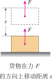
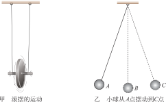
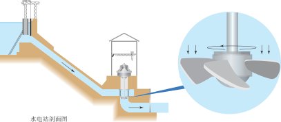

# 功和机械能

  

    
初中物理核心主线

    <h2>从“力让物体移动”到“能量相互转化”</h2>
    

      这一章要抓住一条线索：<strong>力做功</strong>，会引起<strong>能量变化</strong>；能量变化的快慢，用<strong>功率</strong>来描述；动能、重力势能和弹性势能之间可以互相转化，它们合起来叫<strong>机械能</strong>。
    

  

  

:::: grid 3

::: card title="功"
判断一个力是否做功，要同时看**有没有力**，以及物体是否在**这个力的方向上移动了距离**。
:::

::: card title="功率"
同样多的功，谁用的时间更短，谁的功率就更大，也就是**做功更快**。
:::

::: card title="机械能"
物体运动、被举高或发生弹性形变时，都可能储存机械能，并在不同形式之间**相互转化**。
:::

::::

## 功 (work)

### 力学中功的定义

如果一个力作用在物体上，物体在这个力的方向上移动了一段距离，就说这个力对物体做了**功**。

::: tip 力学中功的定义
🎯 **功**等于力与物体在力的方向上移动的距离的乘积。
:::

**做功的两个必要因素**

1. 作用在物体上的**力**。
2. 物体在这个力的方向上移动了**距离**。

只要缺少其中任何一个条件，就没有做功。

### 功的计算

::: formula
$$
W = Fs
$$

- $W$：功 —— 焦耳（J）
- $F$：力 —— 牛顿（N）
- $s$：距离 —— 米（m）
:::

### 怎样判断“有没有做功”

:::: grid sidebar-left card

::: grid-item

:::

::: grid-item
判断时不要只看“用了力”，还要看“物体是否沿这个力的方向移动”。

- 推箱子，箱子向前移动：推力做了功。
- 举着书包站着不动：有力，但没有距离，不做功。
- 背着书包水平前进：支持力竖直向上，位移水平，支持力通常不做功。
- 踢足球后，脚离开足球：脚对球不再施力，也就不再做功。
:::

::::

**没有做功的场景**

:::: grid 3
::: card

有距离无力 $F=0$
:::

::: card

有力无距离 $s=0$
:::

::: card

力与运动方向垂直 $F\perp s$
:::
::::

**有做功的场景**

:::: grid 3
::: card

力与运动方向相同
:::

::: card

力与运动方向不垂直
:::
::::

### 功的单位

- 国际单位：焦耳，简称焦，符号是 $\text{J}$
- $1\text{J}=1\text{N}\cdot\text{m}$

### 学习这一节最容易混淆的点

::: card title="“费力”不一定等于“做功多”"
做功多少看的是 $W=Fs$，既要看力，也要看在力的方向上移动的距离。比如托着重物原地不动，虽然很累，但从物理意义上说并没有做功。
:::

## 功率 (power)

单位时间内所做的功叫做**功率**。功率是表示做功**快慢**的物理量。

::: tip 功率的定义
🎯 功与做功所用时间之比叫作**功率**。
:::

### 功率的计算

::: formula
$$
P=\frac{W}{t}
$$

- $P$：功率 —— 瓦特（W）
- $W$：功 —— 焦耳（J）
- $t$：时间 —— 秒（s）
:::

在做匀速直线运动的情境中，还常用：

::: formula
$$
P = Fv
$$
:::

这说明：速度一定时，力越大，功率越大；力一定时，速度越大，功率也越大。

### 功率的单位

- 国际单位：瓦特，简称瓦，符号是 $\text{W}$
- 常见更大单位：千瓦（$\text{kW}$）
- $1\text{kW}=1000\text{W}$

### 生活中的例子

- 两台起重机把相同重物提升到同样高度，做功相同；用时更短的那台，功率更大。
- 汽车爬坡时，如果发动机输出功率更大，通常更容易保持速度。

## 动能和势能

::: info 能的定义
一个物体能够对外做功，我们就说这个物体具有**能量**，简称**能**。
:::

### 动能

::: info 动能的定义
物体由于**运动**而具有的能，叫做**动能** (kinetic energy)。
:::

一切运动的物体都具有动能。

- 影响因素：**质量**、**速度**
- 质量越大、速度越大，动能通常越大

### 势能

::: info 势能的定义
物体由于受到重力并处在一定高度时所具有的能，叫作**重力势能**。

物体由于发生弹性形变而具有的能叫作**弹性势能**。

重力势能和弹性势能是常见的两种**势能** (potential energy)。
:::

### 三种机械能对比

| 名称 | 产生原因 | 典型影响因素 | 常见情景 |
| :--- | :--- | :--- | :--- |
| 动能 | 物体运动 | 质量、速度 | 行驶的汽车、飞行的足球 |
| 重力势能 | 物体被举高 | 质量、高度 | 高处的石块、蓄水坝中的水 |
| 弹性势能 | 物体发生弹性形变 | 形变大小 | 被压缩的弹簧、拉开的弓 |

## 机械能的转化与守恒

### 机械能

动能、重力势能和弹性势能统称为**机械能** (mechanical energy)。

### 常见转化

  高处下落
  重力势能
  →
  动能

  物体上升
  动能
  →
  重力势能

  弹簧回弹
  弹性势能
  →
  动能

::: card

图甲中，滚摆下降时，它的重力势能越来越小，动能越来越大，重力势能转化为动能。滚摆上升时，它的动能越来越小，重力势能越来越大，动能转化为重力势能。

图乙中，小球从 A 点下落到 B 点，重力势能逐渐转化成动能，到最低点 B 时动能最大，之后又从B点上升到 C点，动能逐渐转化成重力势能。
:::

### 机械能守恒

当只有动能和势能相互转化时，机械能总量保持不变，这就是**机械能守恒** (Conservation of Mechanical Energy)。

更通俗地说：

- 忽略摩擦和空气阻力时，物体“快一点”，往往意味着动能更大
- 物体“高一点”，往往意味着重力势能更大
- 动能减少了多少，势能就会增加多少；反过来也一样

### 典型场景

- **自由下落**：越落越快，重力势能减小，动能增大。
- **抛出的物体上升**：速度越来越小，动能减小，重力势能增大。
- **单摆摆动**：最低点动能最大，最高点重力势能最大。
- **弹簧玩具弹起**：弹性势能转化为动能，再转化为重力势能。

### 应用：水力发电里的能量转化

::: card

:::

水力发电站是这一章最典型的综合应用场景。水被拦在高处时，具有较大的**重力势能**；水流下冲时，重力势能转化为**动能**；高速水流推动水轮机时，水和水轮机的机械能再传给发电机，最终转化为**电能**。

  高处的水
  重力势能
  →
  水流动能
  →
  水轮机机械能
  →
  电能

这也说明：现实中的能量转化不一定只发生在机械能内部，机械能还可以继续转化成电能、内能等其他形式的能。

## 实验探究

### 来自 PhET 的在线仿真实验

[能量滑板公园](./phet-energy)

访问 [PhET 网站](https://phet.colorado.edu/) 查看所有在线仿真实验

## 速记

::: card

- **功**：力和在力的方向上移动的距离同时存在，才有功。
- **功率**：表示做功快慢，常用公式是 $P=\frac{W}{t}$。
- **机械能**：动能、重力势能、弹性势能的总称。
- **守恒条件**：只有动能和势能相互转化时，机械能总量不变。

:::
